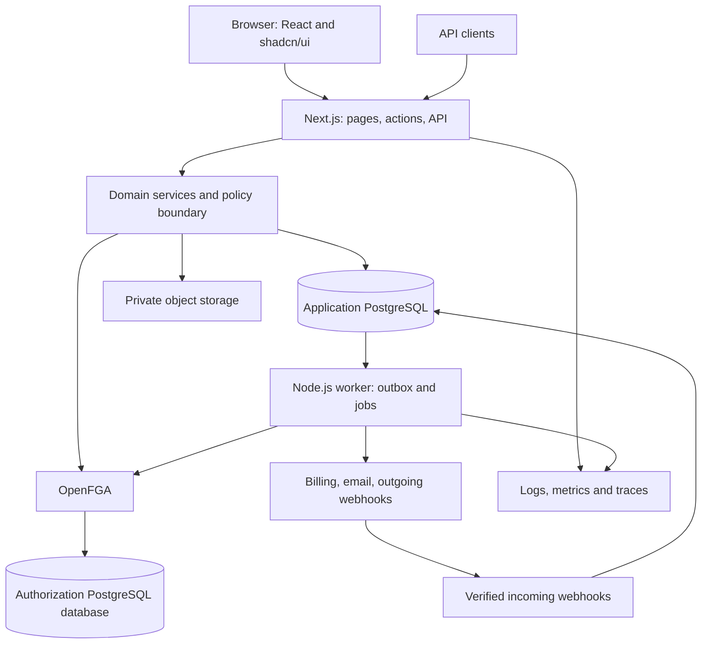

# 2. Architecture and security

## 2.1 Stack decisions

These are proposed architectural choices, not claims that every dependency or integration has been tested together. Phase 0 pins a compatible, supported version set and verifies the adapters.

| Area | Default | Reason and boundary |
| --- | --- | --- |
| Runtime | Supported Node.js LTS, strict TypeScript | Shared language for web, workers, tooling, and domain code |
| Web | Next.js App Router + React | Server-rendered shell and reads, client components for interactive controls |
| UI | shadcn/ui, Tailwind CSS, Lucide icons | Owned component source and a reusable visual system |
| Forms and tables | React Hook Form, Zod, TanStack Table | Typed validation and standard complex dashboard interactions |
| Package management | pnpm workspaces, Turborepo | Explicit package boundaries and incremental build tasks |
| Database | Supported PostgreSQL major, Drizzle ORM/Kit, node-postgres | SQL control, typed queries, connection-bound transactions, migration generation |
| Authentication | Better Auth behind an identity adapter | Reuse authentication/session handling; domain services own organization lifecycle |
| Authorization | OpenFGA, separate service/database | Express resource relationships, inheritance, teams, and sharing |
| Background work | pg-boss + a Node.js worker | PostgreSQL-backed durable jobs; avoid mandatory Redis initially |
| Fixed/seat billing | Stripe Billing, Checkout, Customer Portal | Hosted payment flow with local access-state projection |
| Metered billing | UsageBillingProvider interface | Local usage/quotas always work; an external charging adapter is optional |
| Storage | Private S3-compatible object store | Provider adapter, signed operations, tenant metadata |
| Notifications | React Email + SMTP/provider adapter | Shared transactional templates; local mail capture |
| API | Next.js Route Handlers, REST `/api/v1`, OpenAPI | One stable public contract; no second API framework by default |
| Observability | OpenTelemetry, structured JSON logging, pluggable error sink | Correlate requests, events, worker runs, and providers |
| Verification | Vitest, Playwright, real PostgreSQL/OpenFGA integration environments | Exercise actual isolation and authorization behavior |
| Deployment | Containers for web/worker/FGA, managed PostgreSQL and object storage | Portable reference deployment; serverless web remains an alternative |

shadcn/ui documents shared UI packages in monorepos; use that arrangement for the component layer. [shadcn/ui monorepo documentation](https://ui.shadcn.com/docs/monorepo)

pg-boss is a PostgreSQL-backed Node.js job system. The template still treats external side effects as potentially repeated and makes consumers idempotent. [pg-boss repository](https://github.com/timgit/pg-boss)

## 2.2 Runtime architecture



Use a modular monolith. A Next.js adapter parses transport input, creates a trusted context, and invokes a domain service. Services coordinate authorization, business rules, repositories, entitlements, and events. Repositories own SQL. Workers call the same services with explicit job/service identities.

Server Components call services directly; they do not perform an HTTP round trip to their own API. Server Actions and Route Handlers are thin entry points to the same services. No business rule should exist only in a page or action.

Next.js documentation treats Server Actions and Route Handlers as entry points that require their own authorization checks. Centralize that enforcement near the data-access boundary and return minimal DTOs. [Next.js authentication guidance](https://nextjs.org/docs/app/guides/authentication)

## 2.3 Planned repository structure

```text
common-sass/
  apps/
    web/
      src/app/(public)/
      src/app/(auth)/
      src/app/(dashboard)/app/[orgSlug]/
      src/app/api/v1/organizations/[organizationId]/
      src/app/api/webhooks/
      src/features/                         # Product UI composed from domain contracts
    worker/src/                             # Job runner, scheduled tasks, projections
  packages/
    config/                                 # Validated environment and product manifest
    db/src/schema/                          # Identity, tenant, commercial, domain schemas
    db/migrations/                          # Ordered SQL and Drizzle metadata
    auth/                                   # Better Auth adapter and session boundary
    authz/                                  # OpenFGA model, projection, checks, assertions
    core/                                   # Context, errors, IDs, events, module contracts
    modules/
      organizations/ teams/ workspaces/ projects/
      billing/ entitlements/ usage/ audit/
      files/ notifications/ integrations/
    api-contracts/                          # Zod DTOs and OpenAPI assembly
    ui/                                     # shadcn/ui, shared layouts/forms/tables
    email/                                  # Transactional templates
    observability/                          # Traces, metrics, logging and redaction
    testing/                                # Factories, multi-tenant fixtures, helpers
    cli/                                    # Project bootstrap and entity generation
  entities/                                 # Application-owned entity specifications
  infra/                                    # Containers, local services, deploy examples
  docs/                                     # Plan, ADRs, module and operator guides
  examples/                                 # Illustrative inputs and extension recipes
  saas.config.ts                            # Product manifest, once implemented
```

Dependency direction: web/worker → modules → core and infrastructure adapters. UI imports public contracts, not server repositories. Mark server packages server-only. Domain modules expose explicit commands, queries, and events; prohibit circular dependencies and another module's private-table writes.

## 2.4 Tenancy contract

**Organization equals tenant.** Users are global identities; memberships connect them to organizations. Organization-scoped data always includes a non-null `organization_id`. There is no global default organization and no request header that can bypass membership validation.

1. Authenticate the session or API key.
2. Resolve the requested organization from a browser path or API path; resolve an ID from a slug through a restricted identity/control-plane lookup.
3. Verify current membership/service-account status and organization security policy. Invites and pre-membership onboarding use narrowly scoped dedicated services.
4. Construct an immutable context containing actor, organization ID, request ID, authentication method, and verified policy state.
5. Run tenant SQL on one connection in one transaction with a transaction-local tenant setting. Repositories require this context and cannot reach an unscoped pool.
6. Apply relationship authorization, entitlement rules, and quota rules for the operation.

A route's organization remains authoritative for that request, even if another browser tab changes a preferred organization setting. Treat a preferred organization cookie as navigation convenience only.

### PostgreSQL defense in depth

Proposed database policy:

- Tenant tables enable and force row-level security (RLS).
- Policies use both read/update visibility (`USING`) and write validation (`WITH CHECK`). Missing tenant context produces no tenant access.
- Use `set_config('app.organization_id', verified_id, true)` inside the transaction; never leave tenant state on a pooled session. SQL identifiers are fixed and values parameterized.
- Runtime roles are non-owners, non-superusers, and lack `BYPASSRLS`, DDL, `TRUNCATE`, and membership in privileged roles. Migration credentials never enter the web runtime.
- Separate credentials for identity tables, application tenant tables, queue operations, authorization storage, and migrations. Workers use the tenant repository boundary for domain data.
- Tenant foreign keys contain `organization_id` on both sides. Tenant uniqueness includes that key.
- An organization ID alone never establishes permission to a resource. RLS isolates tenants; services enforce actor-level ReBAC.

PostgreSQL documents owner/superuser bypass behavior, `FORCE ROW LEVEL SECURITY`, and commands/constraints outside row-policy filtering. RLS therefore supplements role restrictions and service checks rather than replacing them. [PostgreSQL row security policies](https://www.postgresql.org/docs/current/ddl-rowsecurity.html)

The tenant session setting is controlled by trusted application code, not a security boundary against arbitrary SQL execution by a compromised application. Products needing infrastructure isolation should use the dedicated deployment extension.

### Isolation beyond SQL

- Cache keys include organization, resource, relevant principal/access revision, and query parameters. Do not publicly cache personalized responses; disable shared caching for tenant data initially.
- Client query caches and optimistic updates include organization ID and are reset appropriately during navigation/logout.
- Files use private keys plus tenant metadata; an object prefix alone never authorizes a download.
- Jobs carry organization and actor/service-account identity, revalidate access at execution, and do not trust stale user permissions captured at enqueue time.
- Search, aggregates, exports, notification payloads, and realtime channels obey the same resource policies as direct reads.
- Customer-provided hostnames require verified ownership and an allowlisted host mapping before enabling custom-domain routing.

## 2.5 Authentication and identity ownership

Use Better Auth for users, authentication accounts, verification challenges, sessions, and MFA. Domain organization and membership records remain the source of truth. Avoid simultaneously running an independent organization-role plugin and an application membership system without an explicit mapping contract.

Better Auth documents SSO and SCIM plugins. Their existence does not establish that organization mapping, licensing, lifecycle hooks, and deprovisioning semantics match this template; prove those points in Phase 0. Self-service SSO configuration may require a vendor offering, so do not assume it is included. [Better Auth SSO](https://better-auth.com/docs/plugins/sso), [Better Auth SCIM](https://better-auth.com/docs/plugins/scim)

Identity rules:

- Never link unrelated identities solely because an untrusted provider asserts the same email address.
- Enforce organization-specific SSO/MFA on every tenant request; a valid session for a different organization may not satisfy it.
- Map SCIM external subjects to an organization connection. Deactivating an employee revokes that membership, not automatically the global user.
- Store API-key hashes, show secrets once, support expiry/rotation, and intersect key scopes with the service account's current permissions and paid access.
- Store only allowlisted identity attributes; encrypt provider secrets and redact them from logs.
- Separate platform operators from customer organization owners. Require MFA and short-lived, audited, reason-bound support access with visible impersonation indicators; deny billing/security modifications by default.

## 2.6 Relationship-based authorization

ReBAC evaluates how an actor relates to a resource. Roles remain useful defaults, represented through relationships instead of hard-coded `role === 'admin'` checks scattered across the application.

Proposed graph:

```text
user ── active member/owner/admin/billing_manager ──> organization
user ── member ──> team ── belongs_to ──> organization
project ── organization ──> organization
project ── optional workspace ──> workspace
user OR team#member ── viewer/editor/manager ──> project
task ── parent ──> project
service_account ── explicit grants ──> organization/resource
```

Example permission semantics, expressed as design pseudocode rather than executable OpenFGA DSL:

```text
project.read   = active_org_member AND (org_admin OR viewer OR editor OR manager)
project.update = active_org_member AND (org_admin OR editor OR manager)
project.delete = active_org_member AND (org_admin OR manager)
project.share  = active_org_member AND (org_admin OR manager)
project.create = active_org_member AND organization.project_creator
billing.manage = active_org_member AND (organization.owner OR billing_manager)
task.read      = active_org_member AND (parent_project.read OR explicit_task_reader)
```

An ordinary member does not automatically read every private project. Owners/admins have the documented content-administration policy; the template can provide a stricter product variant. A viewer role is scoped to an explicitly assigned resource/container. Every grant target and group must belong to the same organization. Disable cross-organization sharing initially; guests receive explicit target-organization memberships.

The pseudocode above describes human membership. Service accounts use an equivalent active, same-organization principal predicate and explicit resource grants; API-key scopes further restrict the result. The initial Project declaration enables human/team sharing; service-account sharing is a separately declared policy capability. Register organization create/list permissions explicitly, and ensure listing permission never implies access to every listed resource.

Expiring grants and guest memberships are checked against trusted server time on every authorization operation, including lists. Model time-bound edges using supported conditions or a tested synchronous eligibility guard; cleanup jobs alone cannot enforce expiry. The generator rejects an expiry declaration if its policy template cannot enforce it.

OpenFGA describes organization/resource types and inherited permissions, as well as organization-context restrictions. These are reference mechanisms for the proposed model. [OpenFGA multi-tenant model](https://openfga.dev/docs/use-cases/multi-tenant-saas), [organization context](https://openfga.dev/docs/modeling/organization-context-authorization)

### Sources of truth and revocation

Application PostgreSQL owns memberships, team membership, resource ownership/parents, and explicit grants. OpenFGA is a derived graph. Only the projector writes graph tuples; manual graph edits are unsupported and reconciled away. Use stable organization-qualified object IDs, an explicit model ID, and a separate store per deployment environment.

**Conservative initial consistency design:**

1. Maintain per-organization `desired_revision` and `applied_revision` plus the active model version.
2. Authorization-changing writes acquire an exclusive organization authorization fence, update source records, advance the desired revision, and append an outbox event atomically.
3. Protected operations take a shared fence for their bounded database transaction, require matching revisions, perform current identity/status checks, then check OpenFGA before reading or mutating domain data. Authorization-changing operations acquire the exclusive fence from the start; do not upgrade a shared lock mid-operation.
4. The projector takes the exclusive fence, applies all changes in order using idempotent desired-state writes, then records the acknowledged revision. Partial failure leaves the organization out of sync and therefore denied for dependent operations.
5. Graph reads use `HIGHER_CONSISTENCY` initially against the primary datastore. Do not interpret this setting as a transaction across PostgreSQL and OpenFGA.
6. Revocation is logically effective when the authoritative database change commits. New dependent operations cannot use the old graph while projection is pending. Already-running operations that obtained the fence complete before that commit; already-delivered data cannot be recalled.

OpenFGA's higher-consistency query option bypasses its caches; it is not an acknowledgement that an application outbox has been applied. [OpenFGA consistency modes](https://openfga.dev/docs/interacting/consistency)

This deliberately trades brief organization-wide unavailability for a clear revocation guarantee. Keep fenced work short, cap remote-call timeouts, monitor projection lag, and test crashes at every step. Preserve read access to minimal account/recovery diagnostics through separately authorized control-plane services. Reduce fence granularity only after proving equivalent guarantees. Resource moves and team/custom-role changes also advance the revision.

### Lists, counts, and field policies

- Authorize before returning DTOs, aggregates, search snippets, or exports. Never return an unrestricted total beside a restricted list.
- The reference list implementation scans tenant-filtered, indexed candidates in stable keyset order and batch-checks permissions within the fence. It continues until it fills the authorized page, exhausts candidates, or reaches a bounded scan budget.
- Return an opaque continuation cursor after the last scanned candidate. A partial or empty page may have a continuation; do not expose internal rejected-item counts. This avoids skipping authorized rows by paginating a raw list and filtering afterward.
- For large sparse access graphs, benchmark permission-aware read models or bounded OpenFGA object enumeration. No unbounded ID list or permission check per table cell. Any read model remains revision-gated.
- Apply field-level read/write allowlists after resource authorization. API input schemas exclude server-owned and privileged fields.

## 2.7 Mutation and API contract

All writes follow: authenticate → resolve tenant → authorize → validate allowed input → check entitlement → reserve quota if needed → perform transactional write/audit/outbox → commit → dispatch effects asynchronously.

- REST resources live under `/api/v1/organizations/{organizationId}/{resource}`; API keys are pinned to one organization.
- Use structured error codes, a safe human-readable message, validation issues, and a request ID. Return `401`, `403`, `404`, `409`, `422`, `429`, or `503` deliberately; conceal resource existence where appropriate.
- Create commands support scoped idempotency keys with request hashes. Retries recheck the caller's current authorization before returning a stored result.
- Use bounded cursor pagination, allowlisted filters/sorts, body-size limits, and explicit bulk-operation caps.
- Use optimistic concurrency (`version`/ETag) for edits; return a conflict instead of silently overwriting concurrent changes.
- Enforce cookie/CSRF/origin controls for browser mutations and explicit CORS for APIs. Route guards improve navigation but do not establish authorization.
- External effects do not occur inside database transactions. Write outbox entries with the domain change and audit event.

## 2.8 Decision register

| Decision | Default | Revisit trigger |
| --- | --- | --- |
| Backend shape | Modular monolith + worker | Independently scaling domain or organizational ownership requires extraction |
| Tenant placement | Shared tables + RLS | Contractual isolation, residency, or a tenant's sustained noisy-neighbor load |
| Authorization | OpenFGA with strict projection fence | Measured latency/availability pressure, with equivalent revocation proof |
| Database migrations | Drizzle SQL generation + reviewed custom SQL | A requirement cannot be expressed or safely maintained in this workflow |
| Organization ownership | Application domain | Identity adapter cannot map enterprise lifecycle safely; resolve before F1 |
| Queue | pg-boss | Queue workload competes materially with database traffic |
| API | REST + shared services | A proven client requirement justifies another transport |
| UI generation | Source files with extension boundaries | No default switch to runtime metadata rendering |
| Monetization | Fixed/seat subscriptions; metered adapter optional | Product requires advanced usage contracts |
| Deployment | Portable containers in one region | Product-specific hosting or availability requirements |
