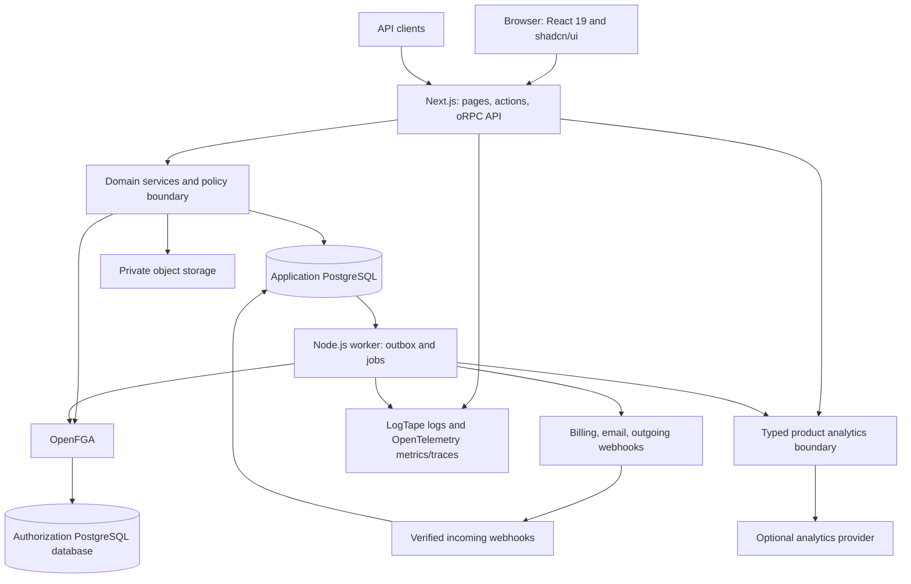

# 2. Architecture and security

## Backoffice first-slice extension

The [BO-01/02-S1 boundary](backoffice/implementation.md) uses a separate staff identity, origin/cookie, restricted database roles and pinned operator FGA publication. Explicit metadata DTOs and current exact-org grants govern the single lookup; no customer role/session or generic superuser authorizes it. Customer processes import no BO runtime. BO-00 implementation decisions and pending deployment security review are [recorded separately](backoffice/bo-00.md).

## 2.1 Stack decisions

The following stack is required for implementation. Phase 0 pins a compatible, supported version set and verifies the adapters, including React 19 compatibility; it does not reopen these technology selections. These are planning requirements, not claims that the dependencies have already been integrated or tested together.

| Area | Required technology | Reason and boundary |
| --- | --- | --- |
| Full-stack framework | Next.js App Router | Server-rendered shell, server entry points, and client components for interactive controls |
| Authentication | Better Auth, self-hosted | Email/password, magic links, passkeys, sessions and MFA; domain services own organization lifecycle and account-deletion orchestration |
| React components | shadcn/ui (Shadcn UI) | Owned component source and a reusable visual system |
| Typed codebase | TypeScript with strict checks | Shared language for web, workers, tooling, and domain code |
| SQL access and migrations | Drizzle ORM and Drizzle Kit | Type-safe SQL queries and reviewed SQL migrations |
| Relational database | PostgreSQL, supported major | Tenant-aware constraints, transactions and row-level security |
| Type-safe API | oRPC | Shared Zod contracts, typed clients and procedures hosted in Next.js; public REST/OpenAPI exposure through oRPC |
| Payments and billing | Stripe Billing, Checkout, Customer Portal | Fixed/seat subscriptions, hosted payment flow and local access-state projection |
| UI library | React 19 | Shared UI baseline for Next.js, components, forms, stories and email compatibility checks |
| Utility CSS | Tailwind CSS | Shared design tokens, themes and utility styling |
| Internationalization | next-intl | Translation catalogues and locale-aware application formatting; English seed catalogue |
| Email templates | React Email | Typed transactional templates with localized content and local previews |
| Validation | Zod | Explicit input/output schemas, forms and environment validation |
| Forms | React Hook Form | Accessible form state and Zod-backed validation; server validation remains authoritative |
| Unit tests | Vitest | Unit suites and integration suites against real PostgreSQL/OpenFGA fixtures |
| End-to-end tests | Playwright | Browser journeys, tenant isolation and image smoke coverage |
| Component development | Storybook | Isolated component development and stories for themes, locales and required UI states |
| Linting and formatting | Biome | Shared formatting and lint rules, enforced locally and in CI |
| Commit conventions | Commitlint | Conventional Commits checked by Git hooks and CI |
| Git hooks | Lefthook | Repository-managed pre-commit checks and commit-msg validation |
| Code cleanup | Knip | Detect unused files, exports and dependencies with explicit framework/tool entry points |
| Package manager | Bun workspaces | Pinned Bun version, committed `bun.lock`, reproducible installs and workspace scripts |
| Typed environment | T3 Env | Zod-backed server/client configuration with separate web, worker and one-off command validation |
| CI | GitHub Actions | Required source checks and Docker image build/verification |
| Logging | LogTape | Structured logs, request/job correlation and shared redaction policy |
| AI coding context | `AGENTS.md` (Agents.md) | Repository instructions for the stack, architecture, commands and feature workflows |

Additional infrastructure supports the required stack:

| Area | Default | Reason and boundary |
| --- | --- | --- |
| Application runtime | Supported Node.js LTS | Runs Next.js and the background worker; Bun manages packages and scripts |
| Build orchestration | Turborepo over Bun workspaces | Explicit package boundaries and incremental build tasks |
| Tables and icons | TanStack Table, Lucide icons | Dashboard interactions composed with shadcn/ui |
| PostgreSQL driver | node-postgres | Connection-bound transactions for Drizzle and tenant context |
| Authorization | OpenFGA, separate service/database; protocol selected in Phase 0 | Express relationships; generation isolation and availability must pass the decision gates |
| Background work | pg-boss + a Node.js worker | PostgreSQL-backed durable jobs; avoid mandatory Redis initially |
| Metered billing | UsageBillingProvider interface | Local usage/quotas always work; an external charging adapter is optional |
| Storage | Private S3-compatible object store | Provider adapter, signed operations, tenant metadata |
| Email delivery | SMTP/provider adapter | Delivers React Email output with local mail capture |
| Product analytics | Typed analytics adapter; PostHog reference integration, disabled without configuration | Product-event/report definitions and tracking controls; separate from audit, operational telemetry, and billable usage |
| Development automation | Repository-local AI agent skills plus deterministic checks | Extend ordinary source using proven services; no custom CRUD generator or entity DSL |
| Traces and metrics | OpenTelemetry, pluggable error sink | Correlate telemetry with LogTape logs across requests, events, workers and providers |
| Image build | Docker BuildKit/buildx | Build and verify the combined application image in CI |
| Packaging | One Docker image containing web + worker and command tooling | PostgreSQL, OpenFGA and object storage supplied through runtime configuration |

Bun is the package manager and script entry point; the application runtime remains Node.js LTS. `bun run test:unit` invokes Vitest, and `bun run test:e2e` invokes Playwright. Phase 0 verifies the Bun workspace/Turborepo install and build path against the chosen Node.js and React 19 versions.

Use T3 Env in `packages/config` with separate server/client schemas and per-process validation. Validate runtime secrets before serving requests, claiming jobs or running one-off commands. Build-time checks must not require production secrets or freeze environment-specific settings into a promoted image. [T3 Env Next.js documentation](https://env.t3.gg/docs/nextjs)

shadcn/ui documents shared UI packages in monorepos; use that arrangement for the component layer. [shadcn/ui monorepo documentation](https://ui.shadcn.com/docs/monorepo)

pg-boss is a PostgreSQL-backed Node.js job system. The template still treats external side effects as potentially repeated and makes consumers idempotent. [pg-boss repository](https://github.com/timgit/pg-boss)

## 2.2 Runtime architecture



Use a modular monolith. oRPC handlers mounted in Next.js Route Handlers validate transport input, create a trusted context, and invoke domain services. Services coordinate authorization, business rules, repositories, entitlements, and events. Repositories own SQL. Workers call the same services with explicit job/service identities. [oRPC Next.js adapter](https://orpc.dev/docs/adapters/next)

The diagram shows logical services, not required container boundaries. The default Docker image runs web and worker as supervised processes in one application container, with graceful shutdown and combined health checks. Their source packages and database roles stay separate; migration credentials are provided only to one-off commands. PostgreSQL, OpenFGA, and object storage remain external.

Server Components call services directly; they do not perform an HTTP round trip to their own API. Interactive clients use the typed oRPC client. oRPC procedures and any Server Actions are thin entry points to the same services. Better Auth endpoints and verified provider webhooks keep their dedicated Next.js handlers. No business rule should exist only in a page, procedure or action.

Next.js documentation treats Server Actions and Route Handlers as entry points that require their own authorization checks. Centralize that enforcement near the data-access boundary and return minimal DTOs. [Next.js authentication guidance](https://nextjs.org/docs/app/guides/authentication)

## 2.3 Planned repository structure

```text
saas-cook/
  apps/
    web/
      src/app/(public)/
      src/app/(auth)/
      src/app/(dashboard)/app/[orgSlug]/
      src/app/api/rpc/[[...rest]]/            # oRPC RPC handler for typed clients
      src/app/api/v1/[[...rest]]/             # oRPC OpenAPI handler for public REST
      src/app/api/auth/[...all]/             # Better Auth handler
      src/app/api/webhooks/
      src/features/                         # Product UI composed from domain contracts
      src/i18n/                             # next-intl routing and request configuration
      messages/                             # next-intl locale catalogues
    worker/src/                             # Job runner, scheduled tasks, projections
  packages/
    config/                                 # T3 Env/Zod schemas and product manifest
    db/src/schema/                          # Identity, tenant, commercial, domain schemas
    db/migrations/                          # Ordered SQL and Drizzle metadata
    auth/                                   # Better Auth adapter and session boundary
    authz/                                  # OpenFGA model, projection, checks, assertions
    core/                                   # Context, errors, IDs, events, module contracts
    modules/
      organizations/ teams/ projects/
      billing/ entitlements/ usage/ audit/
      files/ notifications/ integrations/ account-lifecycle/
    api-contracts/                          # oRPC contracts, Zod DTOs, OpenAPI metadata
    api/                                    # oRPC procedures/router and trusted context
    ui/                                     # shadcn/ui, Tailwind, React Hook Form, stories
      .storybook/                           # Storybook configuration and providers
    email/                                  # React Email templates and localized content
    analytics/                              # Typed events, tracking policy, provider adapter
    observability/                          # LogTape/redaction, OpenTelemetry traces/metrics
    testing/                                # Factories, multi-tenant fixtures, helpers
  AGENTS.md                                # AI coding context and canonical commands
  .agents/skills/                           # Planned SKILL.md packages and references
  .github/workflows/                        # Source checks and image build
  infra/docker/                             # Combined application image
  scripts/                                  # Build and local verification commands
  docs/                                     # Plan, ADRs, module and operator guides
    feature-briefs/                         # Human-readable tasks and acceptance criteria
  examples/                                 # Illustrative inputs and extension recipes
  package.json                              # Bun workspaces, pinned packageManager, scripts
  bun.lock                                  # Committed dependency lockfile
  turbo.json                                # Workspace task graph
  biome.json                                # Biome lint and formatting rules
  commitlint.config.ts                      # Conventional Commits policy
  lefthook.yml                              # pre-commit and commit-msg hooks
  knip.config.ts                            # Workspace entry points and cleanup policy
  vitest.config.ts                          # Unit and integration test projects
  playwright.config.ts                      # End-to-end browser projects
  saas.config.ts                            # Product manifest, once implemented
```

Dependency direction: web/worker → modules → core and infrastructure adapters. UI imports public contracts, not server repositories. Mark server packages server-only. Domain modules expose explicit commands, queries, and events; prohibit circular dependencies and another module's private-table writes.

## 2.4 Tenancy contract

**Organization equals tenant.** Users are global identities; memberships connect them to organizations. Organization-scoped data always includes a non-null `organization_id`. There is no global default organization and no request header that can bypass membership validation.

1. Authenticate the session or API key.
2. Resolve the requested organization from a browser path or API path; resolve an ID from a slug through a restricted identity/control-plane lookup.
3. Verify application recovery readiness, global user lifecycle status, current membership/service-account status, organization lifecycle state, and security policy. Invites, owner recovery, and pre-membership onboarding use narrowly scoped dedicated services.
4. Construct an immutable context containing actor, organization ID, request ID, authentication method, and verified policy state.
5. Run tenant SQL on one connection in one transaction with a transaction-local tenant setting. Repositories require this context and cannot reach an unscoped pool.
6. Apply relationship authorization, entitlement rules, and quota rules for the operation.

A route's organization remains authoritative for that request, even if another browser tab changes a preferred organization setting. Treat a preferred organization cookie as navigation convenience only.

### PostgreSQL defense in depth

Proposed database policy:

- Tenant tables enable and force row-level security (RLS).
- Policies use both read/update visibility (`USING`) and write validation (`WITH CHECK`). Missing tenant context produces no tenant access.
- Use `set_config('app.organization_id', verified_id, true)` inside the transaction; never leave tenant state on a pooled session. SQL identifiers are fixed and values parameterized.
- Runtime roles are non-owners, non-superusers, and lack `BYPASSRLS`, DDL, `TRUNCATE`, and membership in privileged roles. Migration credentials never enter the web runtime.
- Separate credentials for identity tables, application tenant tables, queue operations, authorization storage, and migrations. Workers use the tenant repository boundary for domain data.
- Tenant foreign keys contain `organization_id` on both sides. Tenant uniqueness includes that key.
- An organization ID alone never establishes permission to a resource. RLS isolates tenants; services enforce actor-level ReBAC.

PostgreSQL documents owner/superuser bypass behavior, `FORCE ROW LEVEL SECURITY`, and commands/constraints outside row-policy filtering. RLS therefore supplements role restrictions and service checks rather than replacing them. [PostgreSQL row security policies](https://www.postgresql.org/docs/current/ddl-rowsecurity.html)

The tenant session setting is controlled by trusted application code, not a security boundary against arbitrary SQL execution by a compromised application.

### Isolation beyond SQL

- Cache keys include organization, resource, relevant principal/access revision, recovery epoch, graph generation, and query parameters. Do not publicly cache personalized responses; disable shared caching for tenant data initially.
- Client query caches and optimistic updates include organization ID and are reset appropriately during navigation/logout.
- Files use private keys plus tenant metadata; an object prefix alone never authorizes a download.
- Jobs carry organization and actor/service-account identity, revalidate access at execution, and do not trust stale user permissions captured at enqueue time.
- Search, aggregates, exports, notification payloads, and realtime channels obey the same resource policies as direct reads.
- Customer-provided hostnames require verified ownership and an allowlisted host mapping before enabling custom-domain routing.

## 2.5 Authentication and identity ownership

Use Better Auth for users, authentication accounts, password hashing and verification, sessions, MFA, email magic links, and passkeys. Application identity commands own registration and password-reset challenge lifecycles. Domain organization and membership records remain the source of truth. Avoid simultaneously running an independent organization-role plugin and an application membership system without an explicit mapping contract.

Better Auth documents SSO and SCIM plugins. Their existence does not establish that organization mapping, licensing, lifecycle hooks, and deprovisioning semantics match this template; prove those points in Phase 0. Self-service SSO configuration may require a vendor offering, so do not assume it is included. [Better Auth SSO](https://better-auth.com/docs/plugins/sso), [Better Auth SCIM](https://better-auth.com/docs/plugins/scim)

Identity rules:

- Never link unrelated identities solely because an untrusted provider asserts the same email address.
- Enforce organization-specific SSO/MFA on every tenant request; a valid session for a different organization may not satisfy it.
- Map SCIM external subjects to an organization connection. Deactivating an employee revokes that membership, not automatically the global user.
- Voluntary removal/demotion preserves a final active owner under the organization lock. Trusted security/SCIM deprovisioning takes precedence: revoke access even for the sole owner, atomically set `owner_recovery_required`, and freeze ordinary tenant operations. Resource ownership transfer or seat reconciliation cannot delay revocation.
- Security deactivation uses a narrowly authenticated directory/operator control-plane command and authoritative local status checks. It can remove access while FGA is unavailable or projection is pending; it never depends on a positive check against a stale graph. Positive membership/grant changes retain the normal admission and authorization requirements. Test deactivation during an FGA outage.
- Owner recovery uses a dedicated control-plane command with independently verified organizational authority, fresh MFA, recorded evidence, and a bounded audited operator scope. Do not automatically promote another member or restore the deprovisioned identity. Admit the verified replacement through the seat boundary and complete graph publication before clearing recovery state. Phase 2 ships this command/runbook together with the minimum production authorization protocol; Enterprise adds the operator UI and real SCIM adapter.
- Store API-key hashes, show secrets once, support expiry/rotation, and intersect key scopes with the service account's current permissions and paid access.
- Store only allowlisted identity attributes; encrypt provider secrets and redact them from logs.
- Separate platform operators from customer organization owners. Require MFA and short-lived, audited, reason-bound support access with visible impersonation indicators; deny billing/security modifications by default.

### Email/password, magic links and passkeys (Foundation)

Use the pinned identity adapter's supported plugins and test their actual behavior in Phase 0. The plugin APIs are integration choices; the following are application requirements. [Better Auth magic links](https://better-auth.com/docs/plugins/magic-link), [Better Auth passkeys](https://better-auth.com/docs/plugins/passkey)

- **Email/password:** registration requires mailbox verification before sign-in. Store only the pinned identity provider's password hash; never log passwords or persist them in email payloads. Bind each pending password hash to its own registration confirmation: a generic email sign-in or another registration link must not activate that password. Duplicate registration must not replace an existing verified identity's credentials. Registration, sign-in and reset requests use shared per-identity/source limits and account-discovery-safe responses. Password authentication records its own method and never supplies MFA assurance.
- **Password reset:** use a distinct purpose-bound, hashed, expiring, single-use challenge for an active, verified identity that already has a password. A GET only displays the reset form; explicit submission consumes the challenge atomically with the credential update under the exclusive user lifecycle fence. Bind the challenge to the credential and independent recovery epochs; reject frozen/deleted users and stale challenges. Revoke existing sessions, including pending MFA sessions, and pending email/password challenges when the reset commits. Do not sign in automatically, remove factors, replace recovery codes or convert a passwordless account. The next password sign-in still satisfies the existing MFA and tenant-policy gates. Test replay/concurrent redemption, expiry, scanner visits, epoch changes, reset-versus-sign-in/revocation races and TOTP/recovery-code completion.
- **Magic links:** high-entropy tokens stored hashed, bounded expiry, atomic single-use redemption across replicas, generic request responses, per-identity/source rate limits, and allowlisted same-origin destinations. Keep tokens out of logs, analytics, referrers, and ordinary persistent job payloads; any necessary email-delivery payload is short-lived and protected. Use an explicit confirmation step so email scanners/prefetchers do not consume sign-in links. Test expired/replayed/concurrently redeemed links, scanners, and wrong-account invitation acceptance. Sign-up through magic links follows the product's registration/invitation policy rather than plugin defaults. Passwordless recovery remains a separate magic-link journey, with no implicit password creation.
- **Passkeys:** support authenticated enrollment, multiple named credentials, listing and revocation, and WebAuthn sign-in. Verify challenge freshness/single use, expected origin, RP ID, and user verification through the identity library; store public credentials only. Require recent authentication for enrollment/removal and maintain a tested recovery path before removing the final usable credential. Use a canonical authentication origin/RP ID with explicit runtime configuration; custom tenant domains redirect there rather than silently changing credential scope.
- **Assurance and recovery:** record verified authentication method/time and relevant assurance in sessions. Email possession or a password alone does not satisfy MFA or enforced enterprise SSO. A passkey satisfies an MFA requirement only when the configured policy accepts the verified user-verification assurance. Recovery, lost-device replacement, linking, and login all recheck global account status and target-organization policy; never reactivate an account with pending/final deletion. Password accounts provide their current password for authenticator setup/removal and recovery-code regeneration in addition to the application's fresh-assurance checks. Test passwordless-only users performing sensitive actions without requiring a nonexistent password.

### Ownership transfer and personal account deletion

Ownership transfer ships in F; the full account-deletion workflow ships in C with the independent journal and provider cleanup. Both use application domain services, not a direct identity-plugin delete endpoint. Block any adapter endpoint that can delete a user without this orchestration.

- A current owner reauthenticates and nominates a verified, active existing member of the same organization. The recipient accepts with fresh authentication; the command rechecks both parties, policy, account status, capacity, expiry, and the expected ownership version. Atomically promote the recipient and demote/remove the outgoing owner as requested through the shared membership transition; audit/outbox and notifications identify both actors. Pending invitations, expired transfers, inactive recipients, and cross-tenant IDs never count as success.
- Personal deletion is global: enumerate every membership and ownership obligation. A continuing organization needs another accepted active owner; the sole owner must complete a transfer or separately authorize and finish the organization's deletion workflow. Never delete an organization or cancel its subscription just because an owner deletes their personal account. Assign resource responsibilities and billing contacts to continuing members as needed.
- Coordinate account closure with membership admission and ownership changes through the account lifecycle fence and lock order in [data model §3.3](03-data-model.md#33-identity-and-organization-tables). Revalidate obligations before freezing the identity; freeze blocks new memberships/ownership and all new user-authorized effects, even before graph projection catches up. Partial cross-organization cleanup is durable and resumable, not a claim of one distributed transaction.
- Revoke sessions, pending sign-in/recovery challenges, passkeys, linked authentication credentials, and support sessions targeting the user. Remove memberships/team/resource grants with idempotent seat release; organization-owned service identities remain with the continuing organization, with any personal secrets reviewed/revoked. Preserve tenant content and minimal historical actor references under explicit retention rules.
- Security/SCIM deprovisioning still takes precedence over ownership protection. If a recipient is deprovisioned during transfer or cleanup, enter the existing owner-recovery flow as needed; never retain or restore the deleting user's access to satisfy ownership.

The resumable deletion, analytics cleanup, and restore protocol is specified in [operations §4.8](04-billing-usage-operations.md#48-export-deletion-and-recovery-lifecycle).

### Product analytics boundary (Commercial core)

Provide server and browser adapters using a shared versioned event catalogue. The server derives organization/user attribution from trusted context; browser events cannot assert authoritative billing, role, or ownership transitions. Deliver server-side success events after commit, with stable event IDs for retry deduplication. Analytics has a bounded, isolated delivery queue and may drop expired events with diagnostics; provider failure never fails a domain transaction or changes permissions, quotas, or billing.

Default collection is off until configured. Apply application, organization, and user tracking controls before enqueue and again before delivery. Allowlist properties, use opaque analytics identifiers, and exclude names, emails, free-form resource content, secrets, and authentication URLs. Disable automatic capture/session replay by default. Operator access to cross-tenant reports is separate from customer access. Provider-independent report definitions and lifecycle cleanup are in [operations §4.9](04-billing-usage-operations.md#49-product-analytics).

## 2.6 Relationship-based authorization

ReBAC evaluates how an actor relates to a resource. Roles remain useful defaults, represented through relationships instead of hard-coded `role === 'admin'` checks scattered across the application.

Proposed graph:

```text
user ── active member/owner/admin/billing_manager ──> organization
user ── member ──> team ── belongs_to ──> organization
project ── organization ──> organization
user OR team#member ── viewer/editor/manager ──> project
task ── parent ──> project
service_account ── explicit grants ──> organization/resource
```

Example permission semantics, expressed as design pseudocode rather than executable OpenFGA DSL:

```text
project.read   = active_org_member AND (org_admin OR viewer OR editor OR manager)
project.update = active_org_member AND (org_admin OR editor OR manager)
project.delete = active_org_member AND (org_admin OR manager)
project.share  = active_org_member AND (org_admin OR manager)
project.create = active_org_member AND organization.project_creator
billing.manage = active_org_member AND (organization.owner OR billing_manager)
task.read      = active_org_member AND (parent_project.read OR explicit_task_reader)
```

An ordinary member does not automatically read every private project. Owners/admins have the documented content-administration policy; the template can provide a stricter product variant. A viewer role is scoped to an explicitly assigned resource/container. Every grant target and group must belong to the same organization. Disable cross-organization sharing initially; guests receive explicit target-organization memberships.

Projects belong directly to their existing Organization. Project viewer/editor/manager and denied relations apply to same-tenant memberships, teams or service accounts. There is no intermediate container or assignment/move operation. The [removal brief](feature-briefs/remove-workspaces.md) records the retired Workspace access policy and supported database/model upgrade; historical models remain immutable.

The pseudocode above describes human membership; `active_org_member` includes an active global account and an active organization membership, checked under the lifecycle fences. Service accounts use an equivalent active, same-organization principal predicate and explicit resource grants; API-key scopes further restrict the result. The initial Project feature enables human/team sharing; service-account sharing is a separately declared policy capability. Register organization create/list permissions explicitly, and ensure listing permission never implies access to every listed resource.

Expiring grants and guest memberships are checked against trusted server time on every authorization operation, including lists. Model time-bound edges using supported conditions or a tested synchronous eligibility guard; cleanup jobs alone cannot enforce expiry. Skills must report unsupported expiry requirements rather than implement a permissive fallback; executable policy tests must reject expired access.

OpenFGA describes organization/resource types and inherited permissions, as well as organization-context restrictions. These are reference mechanisms for the proposed model. [OpenFGA multi-tenant model](https://openfga.dev/docs/use-cases/multi-tenant-saas), [organization context](https://openfga.dev/docs/modeling/organization-context-authorization)

### Sources of truth and revocation

Application PostgreSQL owns memberships, team membership, resource ownership/parents, and explicit grants. The replacement Phase 0 candidate supplies a bounded, request-local policy context to OpenFGA instead of publishing persistent permission graphs. OpenFGA still evaluates every possible positive decision against the pinned model. Application resource IDs remain stable; every authorization query qualifies graph references with organization, recovery epoch and a fresh request namespace. See [ADR P0-AUTHZ-2](phase0/contextual-authorization.md).

**Required consistency contract for the contextual candidate:**

1. Maintain the organization source revision, evaluation mode, pinned model/store, recovery epoch and readiness gate. Contextual source changes advance desired/applied revisions in the same transaction; their equality never substitutes for recovery revalidation.
2. Authorization-changing writes follow the [canonical lifecycle lock order](03-data-model.md#canonical-lifecycle-lock-order), acquire the organization authorization fence exclusively from the start, and atomically update source records, revision, domain records and required audit/outbox data. A separate read-only shared-fence preflight may obtain the OpenFGA result before the mutating transaction. Under the exclusive fence, reconstruct all permission inputs and recheck membership/readiness; reuse that invocation’s result only if every input, model and epoch is identical and no condition has expired. Otherwise evaluate again. No lock upgrade or asynchronous permission publication is needed.
3. Protected reads and ordinary updates hold shared lifecycle/authorization fences for their bounded database transaction. Validate local identity/membership eligibility and server-time expiry, recovery readiness, model and evaluation mode; load the relevant authoritative relationships; evaluate the resulting context through OpenFGA before domain SQL and commit.
4. Contexts are specific to the validated policy compiler and model. Cap graph depth, candidate batch size and contextual tuple count; reject unsupported/oversized input rather than truncate it or grant broadly. A source-side filter may prove the absence of a necessary grant path, but every possible positive result requires OpenFGA evaluation. Qualify every object and team/parent/organization traversal in the same fresh request namespace.
5. Queries use the pinned model and `HIGHER_CONSISTENCY`. A missing response, remote error or timeout cannot authorize a protected operation. Contextual tuples are never written or reused in another request; persisted tuples in old request/projection namespaces cannot grant access to a new namespace.
6. Revocation is logically effective at the authoritative commit. Earlier fenced operations drain before it; later operations read the changed source immediately. A lost database connection invalidates the whole protected transaction even if an earlier HTTP query eventually returns allowed. Already-delivered data cannot be recalled.

OpenFGA's higher-consistency option is not a cross-service transaction. Safety comes from the database fence, the current source context, request namespace isolation and committing protected SQL on that same live connection. [OpenFGA contextual tuples](https://openfga.dev/docs/interacting/contextual-tuples), [consistency modes](https://openfga.dev/docs/interacting/consistency)

### Late writes and projection generations

A PostgreSQL lock alone cannot fence an in-flight request to another service. Required failure scenario: attempt A sends a grant at revision N and loses its database connection; attempt B recovers and applies N, then N+1 revokes the grant; A's old request completes last. The old grant must remain unusable even when desired/applied revisions match. Client cancellation, retries, and periodic reconciliation do not establish this guarantee. OpenFGA documents atomicity within a write request, which does not order separate requests against the application's lock. [OpenFGA tuple writes](https://openfga.dev/docs/getting-started/update-tuples)

The **rejected historical full-copy candidate** used a fresh, never-reused graph namespace for **each projection attempt**. Its implementation and fault evidence remain available for regression testing; the contextual candidate above supersedes its publication mechanism:

1. Persist the attempt ID, generation, source revision, model, recovery epoch, and state before sending writes. Build from a consistent snapshot of authoritative organization relationships.
2. Materialize the complete organization graph in that generation. Qualify every graph object and userset traversal with the generation; no parent/team/organization edge may reach a mutable or different generation. Stable principal IDs remain subject to current local eligibility checks.
3. Treat the snapshot as fixed. Known retries may only repeat identical desired tuples. Any ambiguous write outcome abandons the candidate; recovery starts a new attempt and namespace. No other attempt writes that namespace, and no published generation is incrementally mutated.
4. Under the exclusive fence, atomically activate the fully acknowledged candidate only if its source revision is still desired and its model/recovery epoch are current. Otherwise abandon it and build from the latest source. An old request can then affect only its retired or abandoned namespace.
5. Retire generations after fenced readers drain. Cleanup may touch only retired/abandoned namespaces and must tolerate late writes recreating unreachable tuples; bound and monitor their storage. Namespace IDs are never reused, including after restores.

The Phase 0 retention fix clears a snapshot's tuple payload atomically when its attempt becomes retired or abandoned, while retaining its small identity/state/manifest record as a namespace tombstone. Expired, unpublished attempts are abandoned as well. Cleanup discovers actual remote tuples through bounded OpenFGA Read pages and deletes only exact organization/epoch/generation matches with terminal attempt records. It persists scan progress only after successful deletes and repeats complete sweeps, so a write arriving after payload compaction is still discovered. Active, building, verified and unknown namespaces are not cleanup targets. This fixes full-snapshot retention in the prototype; it does not approve the full-copy protocol or prove a finite bound on tombstone metadata, remote backlog, or OpenFGA's own change history. See the [retention implementation and measurements](phase0/authorization.md#snapshot-retention-fix).

The full-copy prototype failed availability and storage budgets. Its replacement is the authoritative request-context design in [ADR P0-AUTHZ-2](phase0/contextual-authorization.md), with the logical schema and shared skill guidance updated together. A database mutex around mutable remote writes remains insufficient, and revocation guarantees and numeric performance targets remain unchanged.

Resource creation with its initial manager grant, deletion, parent moves, and team changes all advance the source revision. Under the contextual protocol, the committed source is immediately available to the next authorized query; there is no graph-publication pending window. Recovery and dependency failures remain explicit unavailable states. Preserve idempotency, distinguish committed mutations from failed commands, keep transactions short and bound remote-call timeouts. Custom-role graphs require a matching compiler/model release and fresh policy/size tests. Minimal account/recovery diagnostics remain separately authorized.

Phase 0 must pass the healthy hot-tenant workload and fault suite in [operations §4.7](04-billing-usage-operations.md#phase-0-authorization-decision-gate), measuring eligible request failures, fence waits, and create-to-readable latency. Sparse authorized lists holding a shared fence must not starve revocations or projection. Re-run the gate on the real Phase 3 feature before extracting reusable agent skills.

### Authorization after restoration

Any application/FGA restore invalidates authorization readiness. Follow the canonical [operations §4.8 recovery protocol](04-billing-usage-operations.md#recovery-readiness-protocol), which owns journal replay, credential invalidation, independent security revalidation, and readiness release. A contextual query or rebuilt historical generation can only reflect its input; neither proves that restored memberships or grants remain authorized. The deletion journal alone cannot establish that ordinary post-backup revocations survived.

### Lists, counts, and field policies

- Authorize before returning DTOs, aggregates, search snippets, or exports. Never return an unrestricted total beside a restricted list.
- The reference list implementation scans tenant-filtered, indexed candidates in stable keyset order and batch-checks permissions within the fence. It continues until it fills the authorized page, exhausts candidates, or reaches a bounded scan budget.
- Return an opaque continuation cursor after the last scanned candidate. A partial or empty page may have a continuation; do not expose internal rejected-item counts. This avoids skipping authorized rows by paginating a raw list and filtering afterward.
- For large sparse access graphs, benchmark permission-aware read models or bounded OpenFGA object enumeration. No unbounded ID list or permission check per table cell. Any read model remains revision-gated.
- Apply field-level read/write allowlists after resource authorization. API input schemas exclude server-owned and privileged fields.

## 2.7 Mutation and API contract

All writes follow: authenticate → resolve tenant → authorize → validate allowed input → check entitlement → reserve quota if needed → perform transactional write/audit/outbox → commit → dispatch effects asynchronously.

Define oRPC contracts with explicit Zod input/output schemas in `packages/api-contracts` and implement the procedures in `packages/api`. Mount the router through Next.js handlers: RPC at `/api/rpc` for typed clients and the oRPC OpenAPI handler at `/api/v1` for the public HTTP contract. The same procedures and domain services serve both transports; define REST methods/paths as oRPC metadata and generate the OpenAPI document from those contracts. [oRPC OpenAPI routing](https://orpc.dev/docs/openapi/routing), [oRPC OpenAPI handler](https://orpc.dev/docs/openapi/handler)

- Public REST resources exposed by oRPC live under `/api/v1/organizations/{organizationId}/{resource}`; API keys are pinned to one organization. RPC organization inputs undergo the same trusted tenant resolution.
- Use structured error codes, a safe human-readable message, validation issues, and a request ID. Return `401`, `403`, `404`, `409`, `422`, `429`, or `503` deliberately; conceal resource existence where appropriate.
- Create commands support scoped idempotency keys with request hashes. Retries recheck the caller's current authorization before returning a stored result.
- Use bounded cursor pagination, allowlisted filters/sorts, body-size limits, and explicit bulk-operation caps.
- Use optimistic concurrency (`version`/ETag) for edits; return a conflict instead of silently overwriting concurrent changes.
- Enforce cookie/CSRF/origin controls for browser mutations and explicit CORS for APIs. Route guards improve navigation but do not establish authorization.
- External effects do not occur inside database transactions. Write outbox entries with the domain change and audit event.
- Verify typed-client inference and runtime schema rejection, and run the same tenant, authorization, idempotency and error-contract cases through both oRPC transports.

### Phase 0 validation outcome (updated 2026-09-23)

The [generation-isolated prototype](phase0/authorization.md) remains rejected for availability/storage. The [contextual replacement](phase0/contextual-authorization.md) retains the generation fault suite and adds real-service policy/late-response tests; its [completed reference run](phase0/contextual-authorization.md#completed-reference-result) passed the original authorization thresholds. Neither a passing functional suite nor an authorization-only gate approves all of Phase 0 or the production application. The [stack, identity, API/database and operational decisions](phase0/README.md) record their own evidence and limitations.

## 2.8 Decision register

| Decision | Default | Revisit trigger |
| --- | --- | --- |
| Backend shape | Modular monolith + worker | Independently scaling domain or organizational ownership requires extraction |
| Tenant placement | Shared tables + RLS | Contractual isolation, residency, or a tenant's sustained noisy-neighbor load |
| Authorization | Authoritative PostgreSQL context plus OpenFGA evaluation under transaction fences; [Phase 0 ADR](phase0/contextual-authorization.md) | Context/model bounds, fault safety or hot-tenant availability gate fails; prove any extension before Phase 2/3 |
| Database migrations | Drizzle SQL generation + reviewed custom SQL | A requirement cannot be expressed or safely maintained in this workflow |
| Organization ownership | Application domain; security deprovisioning overrides voluntary last-owner protection | Mapping, sole-owner recovery, or seat-admission spike fails; resolve in Phase 0 |
| Queue | pg-boss | Queue workload competes materially with database traffic |
| API | oRPC contracts/procedures + shared services; typed RPC and public REST/OpenAPI adapters in Next.js | Contract/versioning or client requirements require adapter changes within oRPC |
| Feature development | AI agent skills edit ordinary source using shared services and deterministic checks | Skill evaluations or platform changes require revised guidance; no custom CRUD generator |
| Monetization | Fixed/seat subscriptions; metered adapter optional | Product requires advanced usage contracts |
| Packaging | One Docker image containing web + worker and command tooling | PostgreSQL, OpenFGA and object storage supplied through runtime configuration |

The [CI and Docker image plan](07-ci-and-docker-image.md) defines the combined application image, build inputs and image verification.
