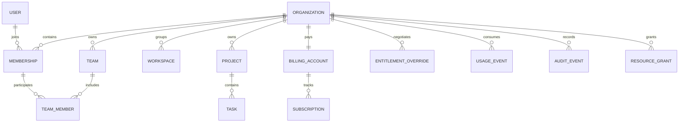

# 3. Data model

## 3.1 Conventions

This is a logical schema specification. Implementation will translate it into Drizzle definitions, generated SQL, custom policies, and migration tests. Identity-provider and queue tables must follow the selected packages' actual schemas.

- Use application-generated UUIDs for public identifiers. IDs must be opaque; secrecy of IDs is never an authorization mechanism.
- Tenant-owned tables require `organization_id NOT NULL`. Global identity/control-plane tables are an explicit reviewed exception.
- Use `timestamptz` in UTC for instants and explicit IANA time zones for presentation/schedules. Store date-only values as dates.
- Most mutable business rows have `created_at`, `updated_at`, `created_by`, `updated_by`, and integer `version`. Soft deletion is opt-in per entity through `deleted_at` and `deleted_by`.
- Represent money as integer minor units plus currency, with currency-aware exponents. Represent fractional measured quantities as fixed-precision decimals and serialize them as strings; never use binary floating point for money.
- Use native columns for stable business fields. Reserve validated JSONB for versioned settings, metadata, and event payloads with documented size limits.
- Index tenant query paths first: `(organization_id, ...)`. Partition only after measured volume justifies it.

## 3.2 Relationship overview

The diagram shows logical relationships, not exhaustive SQL constraints. Polymorphic grant targets need a resource registry or service-validated lifecycle; a text `resource_type/resource_id` pair does not by itself provide referential integrity.

## 3.3 Identity and organization tables

| Table or group | Essential data and rules |
| --- | --- |
| `users`, `auth_accounts`, `sessions`, `verification_challenges`, `mfa_credentials` | Global authentication records owned by the identity adapter; user status, verified identities, session expiry/revocation; never expose full rows as DTOs |
| `user_preferences` | User, locale, time zone, theme; own-user access only |
| `organizations` | ID, unique routing slug, display name, status, locale, time zone, deletion scheduling; an explicitly controlled registry table |
| `memberships` | Organization, user, status, baseline role, billable classification, joined/suspended timestamps; unique `(organization_id, user_id)` |
| `invitations` | Organization, normalized destination identity, token hash, requested membership, inviter, expiry, acceptance/cancellation; single-use atomic acceptance |
| `teams`, `team_members` | Organization, team name/slug; membership references with same-tenant constraints; no nested teams in first release |
| `workspaces` | Organization, name/slug, archived state; optional subdivision module |
| `organization_settings`, `security_policies` | Typed settings and security requirements, policy version; organization-wide changes audited |
| `verified_domains` | Organization, hostname, verification challenge/status/expiry; uniqueness and takeover protection |
| `sso_connections`, `directory_connections`, `directory_subjects` | Organization-scoped provider mappings, encrypted credentials, external stable subjects, sync state, source ownership |
| `service_accounts`, `api_keys` | Organization, lifecycle status, explicit grants; key prefix/hash, scopes, expiry, last-used timestamp; secrets shown only once |

Prevent removing or suspending the final active owner under concurrent requests using an organization-level lock. Ownership transfer is a dedicated command, not an unrestricted membership PATCH. Invitation tokens, reset tokens, and API keys are never stored in plaintext application logs.

Global identity access uses narrowly scoped adapters and separate DB privileges. Tenant users must not obtain a global user directory by querying `users`; member listings expose only authorized organization membership projections. Organization creation, slug lookup, and cross-organization membership navigation use explicit control-plane services, not an RLS bypass flag.

## 3.4 Authorization and domain tables

| Table | Essential data and rules |
| --- | --- |
| `resource_registry` | `(organization_id, resource_type, resource_id)`, parent pointer, lifecycle state; allows explicit grants to reference known resources |
| `resource_grants` | Organization, registered target, subject membership/team/service account, relation, expiry, grantor; unique normalized edge; reject cross-tenant subjects/parents |
| `roles`, `role_permissions`, `role_assignments` | Tenant custom-role definitions from a versioned platform permission catalogue; assignments to validated subjects and scopes |
| `authorization_revisions` | One row per organization: desired/applied revision, active model version, failure/reconciliation status |
| `projects` | Organization, ID, name, tenant-unique slug, description, status, owner membership, version, timestamps; optional soft deletion |
| `tasks` | Optional reference extension: organization, ID, required parent project, title, state, assignee membership, version/timestamps |

Use dedicated nullable subject columns with a CHECK requiring exactly one of membership/team/service account, or introduce a typed principal registry. Do not rely on an unconstrained subject string. Register/unregister resources and create/remove their local grants in the same transaction as domain lifecycle changes; graph projection follows the outbox.

Every resource table provides a unique `(organization_id, id)` target for child composite foreign keys. For example, `(organization_id, project_id)` in `tasks` references `(organization_id, id)` in `projects`. An owner field references a membership in the same organization. Parent moves require authorization on both locations and a graph revision change.

The actual OpenFGA tuple storage is in its own database and managed by OpenFGA migrations. Application code never writes its internal tables.

## 3.5 Billing, entitlements, and usage tables

| Table | Essential data and rules |
| --- | --- |
| `billing_accounts` | Organization, billing mode, provider/customer mapping, currency, contacts; initially one per organization |
| `plans`, `plan_versions`, `prices`, `plan_features` | Global controlled catalogue; immutable sold versions, provider price mappings, feature types/limits |
| `subscriptions`, `subscription_items` | Organization, provider IDs, raw provider status, normalized access state, price/quantity, periods, scheduled changes, last reconciliation |
| `invoices` | Organization, provider ID, currency, amounts, status, hosted invoice reference; projected data, not a custom accounting engine |
| `entitlement_overrides` | Organization, feature, typed value, effective interval, reason, author, optional contract reference |
| `entitlement_snapshots` | Organization, computed feature map, source versions, validity interval, synchronization health |
| `billing_commands` | Organization, operation ID, idempotency key/hash, requested change, provider response reference, completion/reconciliation state |
| `usage_metrics` | Stable key, unit, aggregation semantics, dimensions allowlist, period policy, charging eligibility, schema version |
| `usage_events` | Organization, event ID/deduplication key, metric, quantity, occurred/received timestamps, source operation, dimensions, correction reference |
| `usage_aggregates` | Organization, metric, aggregation version, period start/end, dimensions hash, total, processed watermark; rebuildable |
| `quota_buckets`, `quota_reservations` | Organization, feature/metric, window, consumed/reserved amounts, expiry, operation key, reservation state |
| `usage_deliveries` | Event/batch, provider, stable external idempotency key, acknowledgement/error status, retry state |
| `billing_reconciliations` | Organization, run, expected/observed values, discrepancy type, resolution and audit reference |

Enforce uniqueness for provider objects using provider account/environment plus external ID. Do not assume an ID from a test account belongs to the live environment. Include organization and operation scope in local idempotency constraints. Keep raw provider status separate from application access decisions.

## 3.6 Audit, integration, and operations tables

| Table or group | Essential data and rules |
| --- | --- |
| `audit_events` | Organization where applicable, actor/effective actor, action/version, target, outcome, UTC time, request/trace ID, allowlisted changes, redacted network context |
| `security_events` | Failed sign-ins, denied access, suspected abuse and platform-level security events; separate read/retention policy |
| `outbox_events` | Event ID, tenant, aggregate, aggregate sequence, type/schema version, payload, timestamp; durable domain-to-worker boundary |
| `consumer_receipts` | Consumer and event ID unique; side-effect state/references; repeated delivery cannot create duplicate business changes |
| `webhook_inbox` | Provider account, event ID unique, signature-verified timestamp, restricted payload, processing state; tenant resolved from trusted mapping |
| `webhook_endpoints`, `webhook_deliveries` | Organization, URL, event allowlist, encrypted signing secrets, rotation state, attempts, response diagnostics |
| `integration_connections` | Organization, provider, external account, encrypted tokens, scopes, expiry, health, revocation state |
| `files` | Organization, registered resource/owner, object key, original filename, bytes, digest, content type, quarantine/scan state, retention |
| `notifications`, `notification_preferences`, `delivery_attempts` | Recipient and tenant context, template/version, channel, read state, delivery outcome; mandatory security notices handled separately |
| `import_jobs`, `export_jobs` | Organization, requesting actor, source/target file, progress, validation errors, authorization/revision context, expiry |
| `feature_flags`, `flag_rules` | Platform-controlled rollout definitions and targeting; typed values and expiration/owner |
| `support_sessions`, `operator_actions` | Operator, tenant, reason/ticket, approved scope, expiry, effective actor and complete action trail |
| `deletion_requests`, `retention_policies`, `legal_holds` | Tenant lifecycle state, effective dates, blocked categories, verification and completion manifest |
| Queue-owned tables | Managed by pg-boss in an isolated schema with restricted credentials and operational retention |

Domain and audit timestamps are independent of delivery timestamps. Events use versioned payloads; consumers declare supported versions. Large exports/log payloads live in private object storage with metadata in PostgreSQL.

## 3.7 Constraints and indexes

Required starting indexes and safeguards:

- Active domain lists: `(organization_id, created_at DESC, id DESC)`; add declared selective filters/sorts based on real queries.
- Tenant slugs: unique `(organization_id, slug)`, with a documented partial-index policy if reuse after soft deletion is allowed.
- Membership lookup: unique `(organization_id, user_id)` and `(user_id, status)` for the user's organization switcher.
- Parent traversal: `(organization_id, parent_id, id)`; grant traversal by target and subject.
- Usage: unique `(organization_id, metric_key, deduplication_key)`; aggregation access by organization, metric, occurred time.
- Reservations: unique `(organization_id, bucket_id, operation_key)` and an expiry scan index.
- Audit: `(organization_id, occurred_at DESC, id DESC)` plus deliberate action/actor filters; avoid indexing sensitive JSON indiscriminately.
- Outbox/inbox: status/available-time indexes, event uniqueness, bounded payloads, aggregate sequence uniqueness where ordering matters.
- Large append-only usage/audit tables may later use time partitions. If partitioning changes the scope of a unique constraint, preserve deduplication in a separate non-partitioned key registry or include the correct partition key.

Check constraints validate nonnegative quantities where appropriate, enum states, valid intervals, and exactly-one polymorphic subject. Corrections use explicit typed adjustment events instead of unrestricted negative usage. Relational integrity is enforced in SQL wherever possible, with services adding lifecycle rules.

## 3.8 Migration and deletion policy

1. Schema changes generate ordered SQL and migration metadata. Review indexes, defaults, constraints, tenant policies, and expected lock/runtime impact.
2. Run migrations once as a deployment step with a dedicated role and migration lock. Application replicas do not each attempt DDL on boot.
3. Use expand → deploy compatible code → backfill in resumable batches → validate → contract. Avoid rewriting large tables in a single request/deployment transaction.
4. Keep concurrent-index creation and other non-transactional operations in explicit migration steps supported by the runner.
5. Test both empty-database creation and upgrade from the previous release. Verify RLS with the actual restricted runtime role.
6. Do not edit applied migrations or generate automatic destructive rollback scripts. Prefer forward fixes and tested recovery plans; document incompatible changes before release.
7. Soft deletion does not satisfy permanent deletion. Purge workflows remove domain data, grants, graph tuples, files, derived search data, credentials, and relevant provider mappings according to retention policy.
8. Deleting one organization does not delete a user's independent memberships or another organization's data. Financial/audit retention and legal holds are explicit policy exceptions recorded in the deletion manifest.
