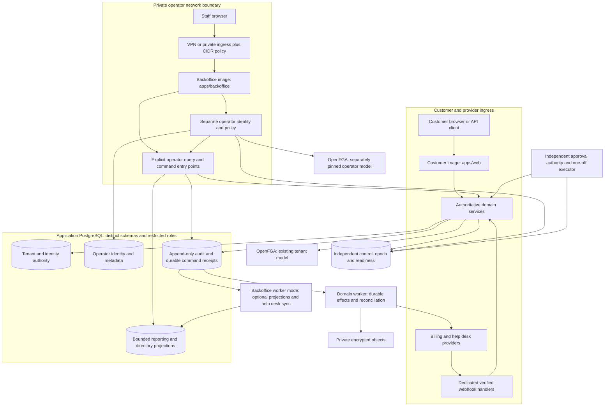

# Backoffice architecture and trust boundaries

Status: **first slice implemented; broader architecture planned**. The inventory below preserves the pre-implementation baseline of 2026-10-21. [BO-00](bo-00.md) records selected first-slice decisions and [implementation](implementation.md) describes the actual runtime; recommendations outside that scope remain planned. Scope is in the [brief](../../feature-briefs/backoffice.md); work/evidence is in the [development plan](development-plan.md); gate status belongs only in the [roadmap register](../06-delivery-roadmap.md#67-backoffice-planned-delivery-and-acceptance).

## Repository baseline and implementation inventory

Inspected source at `94507a78d7f17f4c134570f0bcab8d70862c272b`; the working tree was clean before this documentation task. No application tests, benchmarks, image builds or provider transactions were executed for this plan. “Recorded” below means the cited repository evidence, not verification of this exact commit. Dependencies and logical schema documents are not proof of services.

| Area | Actual source / evidence | Status and consequence |
| --- | --- | --- |
| Workspace and stack | [root manifest](../../package.json), [lockfile](../../bun.lock), [AGENTS.md](../../AGENTS.md) | Bun 1.4.2; Node tools 24.19.0; application image Node 24.22.0; exact dependency versions remain in the manifest/lockfile. No `apps/backoffice` |
| Customer routes/composition | [Next config](../../apps/web/next.config.ts), [runtime](../../packages/api/src/runtime.ts), [router](../../packages/api/src/router.ts), [feature map](../development/feature-workflow.md) | One customer Next application; localized account/org/Project/example-customer pages; RPC, REST and OpenAPI. Runtime composes real identity, tenant, resource, key and example-customer services |
| Identity | [identity runtime](../../packages/auth/src/index.ts), [ingress](../../packages/auth/src/ingress.ts), [Phase 2 acceptance](../phase2/acceptance.md) | Customer Better Auth/session/MFA/password/passkey boundary exists. Signed ingress protects authentication source attribution; it is not a general Backoffice CIDR gate. No separate staff directory, enrollment or SSO integration |
| Tenancy/capacity | [tenancy](../../packages/db/src/tenancy.ts), [resources](../../packages/db/src/resources.ts), [schema](../../packages/db/src/tenancy-schema.ts) | Current lifecycle fences, owner/seat transitions, local policy and resource capacity. Existing `TenantActor` assumes a customer; two narrowly scoped `ControlPrincipal` commands are not a general operator API |
| Authorization | [resource checks](../../packages/authz/src/resources.ts), [model](../../packages/authz/src/model.ts), [keys](../../packages/authz/src/keys.ts) | Pinned bounded contextual FGA; no production permission tuples; per-endpoint key support. No operator model or platform permissions |
| Independent controls | [control store](../../packages/authz/src/control.ts), [approval verification](../../packages/authz/src/operator.ts), [command runner](../../scripts/phase2/owner-command.ts), [runbook](../phase2/authorization.md) | Separate installation binding/epoch/readiness, model-upgrade and signed-approval receipts. Runtime reader can read installation publication, not write approvals. Phase 6 implements [independent journal](../../packages/authz/src/journal.ts), [restore revalidation](../../packages/authz/src/recovery.ts) and `control:schema`; recorded restore tests and remaining release limits are in [acceptance](../phase6/acceptance.md). Operator publication and staff restore invalidation remain new work |
| Schema history | [migration journal](../../packages/db/migrations/meta/_journal.json), [migration guide](../../packages/db/migrations/README.md) | `0000`–`0024` present; Phase 5 billing and Phase 6 files/platform/lifecycle/delivery migrations extend the Foundation sequence. `0002` tenancy, `0003` authorization, `0004` identity, `0005` event integrity, `0006` predecessor resources, `0007` direct-org Projects, `0008` example customers, `0009` personal settings. File presence does not prove any ambient database has applied them |
| Roles/RLS | [role setup](../../infra/postgres/init.sql), [control roles](../../infra/control/init.sql), [tenancy SQL](../../packages/db/migrations/0002_tenancy.sql), [resource SQL](../../packages/db/migrations/0006_resources.sql) | Restricted web, worker, identity, migrator plus Phase 6 lifecycle, recovery and platform-operator CLI roles; forced tenant RLS and composite FKs. Existing narrow lookup functions are reviewed exceptions. No Backoffice runtime role or staff principal; the flag/report CLI role is not a substitute. Do not reuse migrator or grant all tables |
| Business records | [example-customer service](../../packages/db/src/example-customers/service.ts), [migration](../../packages/db/migrations/0008_example_customers.sql) | Customer-authored tenant data, not platform organizations. Separate new operator directory required |
| Audit/outbox/email/jobs | [audit helper](../../packages/db/src/tenancy.ts), [worker](../../apps/worker/src/index.ts), [encrypted mail](../../packages/email/src/delivery.ts) | Atomic tenant audit/outbox, identity security audit, encrypted bounded mail retries, pg-boss runtime probe/heartbeat. Identity audit currently has identity-role UPDATE/DELETE grants in `0004`; do not claim universal append-only audit. Billing dispatch/reconciliation and bounded platform consumers now exist; customer audit access/query/export is separately granted. No general staff read audit, dead-letter console or universal replay engine |
| Private storage | [avatar](../../packages/auth/src/avatar.ts), [personal SQL](../../packages/db/migrations/0009_personal_settings.sql) | Private database avatars plus [immutable S3 files](../phase6/files.md) and bounded encrypted [bulk exports](../phase6/platform-modules.md). Existing exports are customer-authorized and limited; operator disclosure requires new scope/audit |
| Config and logging | [server config](../../packages/config/src/server.ts), [client allowlist](../../packages/config/src/client.ts), [observability](../../packages/observability/src/index.ts) | Lazy runtime initialization supports credential-free builds; public config only app name/locale. Preserve redaction and server-derived correlation; add separate process schemas |
| Packaging | [Dockerfile](../../infra/docker/Dockerfile), [entrypoint](../../infra/docker/entrypoint.mjs), [supervisor](../../infra/docker/supervisor.ts), [build runtime](../../scripts/phase1/build-runtime.ts) | One `app` target copies customer standalone output, assets, bundled worker/commands/supervisor and migrations. Customer image intentionally includes one-off signed operator CLI modes, but no operator HTTP routes |
| CI | [workflow](../../.github/workflows/ci.yml), [image tests](../../scripts/phase1/image-test.ts), [scan policy](../../security/README.md) | Source/unit/integration/browser/Storybook/production/image plus `required`; scans exact image `saas-cook:phase2`; historical Foundation evidence remains scoped; [Phase 5](../phase5/acceptance.md) and [Phase 6](../phase6/acceptance.md) record later CI/image checks and limitations. Current source/build scripts explicitly select web and must be expanded |
| Authoring | [skills](../development/agent-skills.md), [verification](../development/verification.md), [Phase 4](../phase4/acceptance.md) | Six local skills and recorded two-candidate `R-SKILLS` acceptance. Disposable Task/renaming/email evaluation outputs are not production modules |
| Commercial/platform modules | [Phase 5](../phase5/README.md), [Phase 6](../phase6/platform-modules.md), [gap inventory](development-plan.md#current-implementation-and-remaining-gaps) | Billing/usage is implemented and accepted for its scope. Files/bulk/deletion/recovery/notifications/settings/analytics are implemented with open Phase 6/M2 release gates. BO authorization, finance overrides/adjustments, privacy case/hold governance, campaigns/help desk and financial reporting remain additional work. SSO/SCIM and delegated support remain later scope |

Read [overview](../00-project-overview.md), [product plan](../01-product-plan.md), [architecture](../02-architecture-and-security.md), [data model](../03-data-model.md), [operations](../04-billing-usage-operations.md), [image contract](../07-ci-and-docker-image.md) and the Phase 2–4 records together. Some overview/status language predates implemented phases. The roadmap and scoped acceptance records resolve that discrepancy; this plan does not rewrite historical results.

Phase 3's real-feature `R-AUTHZ-PERF` **passed** in the subsequent [manual 2026-09-27 run](../phase3/acceptance.md#accepted-direct-project-performance-result): stable `direct-project-v1` source, 1,800.678 measured seconds, 50 clients, 524,149 successful operations with zero retries, all latency targets met, and reconciled share/read and revoke/deny confirmations. The predecessor parent-move benchmark remains invalid as acceptance. The [direct-Organization Project removal](../../feature-briefs/remove-workspaces.md) records correctness checks and the earlier smoke; the separate [Foundation closeout](../foundation/acceptance.md) now accepts M1 with current image/security, refreshed skills and hosted CI evidence. Backoffice production-capable implementation/release prerequisites remain in BO-00, without inheriting the historical Phase 4 exception; changed workloads and images require their own evidence.

## Decisions and alternatives

| ADR | Recommendation | Alternatives and revisit trigger |
| --- | --- | --- |
| BO-ADR-01: application boundary | Independent `apps/backoffice`, private operator routes, separate hostname, identity, config, processes and image | A customer `/operator` route fails the requested independent packaging/session/deployment boundary. A separate repo loses useful atomic source review without improving runtime security |
| BO-ADR-02: service calls | Backoffice server calls explicit exported domain services in-process; operator RPC contracts/router are separate | A private internal API can isolate domain credentials from a compromised UI process but adds service identity, transport availability and versioning. Extract if security requires that isolation, separate team ownership develops or load needs independent scaling. Do not call customer HTTP endpoints with manufactured sessions |
| BO-ADR-03: database | One application database initially; `operator_identity`, `backoffice` and `reporting` schemas with distinct restricted roles | A separate operator database isolates backups/credentials more strongly, but introduces cross-database authorization and audit/command consistency. A separate reporting database/read replica is a measured evolution, not a starting microservice requirement |
| BO-ADR-04: recovery authority | Existing independently retained control store remains separate; ordinary Backoffice has read-only readiness | Never move the journal/epochs into Backoffice metadata or restore them from an application backup. Add independently migrated operator publication metadata without coupling customer readiness to operator availability |
| BO-ADR-05: principals | New platform operator principal, action catalogue and bounded contextual operator policy model, separately pinned from the customer model | No `isSuperuser`, BYPASSRLS, role-based customer impersonation or generic `skipAuthorization`. Existing tenant model remains unchanged for initial metadata reads; future business-content delegation needs a separately reviewed extension |
| BO-ADR-06: jobs | Domain workers own durable commercial/privacy/control delivery. Backoffice image gains a separate `worker` mode only for Backoffice projections/integration sync/reporting | No operator credentials in the existing customer worker; no worker dependency in the BO-01 read-only web image health. Later Backoffice web/worker use separate processes and credentials, same artifact/version. A third image is unnecessary until dependency size/isolation warrants it |
| BO-ADR-07: provider ingress | Phase 5/6 verified webhooks remain on the customer service's dedicated provider route, with one inbox and domain consumer | Private Backoffice behind VPN cannot be the sole public billing endpoint. No duplicate billing projector, retry scheduler or subscription store |
| BO-ADR-08: release contract | Independent app versions/digests plus an explicit schema/event/policy compatibility manifest | Independence is not arbitrary version mixing. Current customer model upgrades require maintenance; retain that behavior until a separately proved compatible upgrade exists |

All ADRs are proposed choices to ratify in BO-00. The shared database deliberately retains common infrastructure failure risk. Application independence means Backoffice outage/disablement does not break customer operations; it does not claim customers survive failure of their shared database or FGA. Limit pools, query time, queues and data privileges to bound Backoffice blast radius.

## Architecture diagram



Arrows to control from ordinary runtimes are **read-only**. Only dedicated initialization/recovery/journal commands get narrowly scoped control write credentials. The diagram's existing and proposed components are distinguished in the inventory; it is a target diagram, not a statement that the workers/projections all exist. No customer request points to Backoffice HTTP or its worker.

## Package layout and dependency direction

Proposed paths below are work locations, not installed packages:

```text
apps/backoffice/
  src/app/[locale]/...                 operator screens
  src/app/api/operator/rpc/...         private browser API, not customer OpenAPI
  src/app/api/operator/auth/...        separate identity endpoints
  src/app/api/health/{live,ready}/...   minimal process checks
  src/features/                       organization, account, case, billing, privacy
  src/lib/runtime.ts                  process-specific composition
  src/worker.ts                       later Backoffice-only worker entry
  next.config.ts, package.json, public/, src/i18n/
packages/backoffice-contracts/        strict DTOs and versioned operator commands
packages/backoffice/                  policy, command orchestration, audit/query services
packages/auth/src/operator/           isolated identity adapter; explicit server export
packages/authz/src/platform/          operator model/compiler/current eligibility
packages/db/src/backoffice/           reviewed schema, bounded queries and repositories
packages/db/src/tenancy.ts            domain-owned explicit operator lifecycle entry points
packages/config/src/backoffice.ts     separate web/worker config validation
scripts/backoffice/                   build, fixtures, browser/image/compatibility checks
infra/docker/backoffice/              entrypoint and health scripts
```

Backoffice UI → its contracts and shared UI; server → `packages/backoffice` → public operator-authorized domain entry points plus infrastructure adapters. Customer web/API never imports `packages/backoffice` or operator identity/routes. Shared domain implementations never import an app, Backoffice UI or an operator transport. Existing `packages/api/src/runtime.ts` must not be reused wholesale: it constructs customer identity pools/cookies and broad customer services. Do not create the illustrative `packages/modules/*` tree merely to match old planning text; reuse the implemented domain boundaries in `packages/db/src/{billing,bulk,lifecycle,settings,analytics}`; package extraction needs a concrete reason, not a planning-tree match.

Avoid a giant shared barrel that causes operator code/credentials to be traced into customer bundles. Use explicit server-only export paths, type-only contracts for clients, dependency lint checks and route/asset inspection. Shared validators, transactional helpers, UI/theme/forms, localization, email rendering, logs and testing helpers can be reused; instantiated customer auth/session runtimes cannot.

## Operator identity and network boundary

Separate Better Auth instance with its own tables, signing/encryption keys, origin, WebAuthn RP ID and named cookie. Customer and operator identities may refer to the same person operationally but have unrelated opaque principal IDs and no implicit linking or permissions. Customer owners, admins, billing users and API keys are rejected by operator endpoints. Operator bearer credentials are not introduced initially; background workloads use purpose-specific execution identities.

Proposed production session: `__Host-backoffice-session`, `Secure`, `HttpOnly`, `Path=/`, no `Domain`, `SameSite=Strict`; 30-minute idle and 8-hour absolute lifetime, server-enforced. Use distinct short-lived state cookies with the narrowly required SameSite behavior if a later SSO callback needs them. Renewals cannot extend the absolute deadline. Check current operator status, role revision and session epoch at each action; offboarding revokes sessions and unstarted approvals/jobs immediately after fenced commit. Recheck minimum session/approval/step-up expiry before disclosure/commit, including all earlier authorization batches. Never rely on a cached browser role.

Enrollment is invite-only: independently verified staff identity, named sponsor and security approver, least-privilege time-bounded assignment, one-use enrollment and passkey user verification. No user can grant themselves privilege. Operator recovery requires independent staff verification; email possession alone cannot reset privilege or MFA. Record periodic access review and temporary-access expiry. Corporate SSO later maps an allowlisted issuer plus immutable subject and reviewed group rules; deprovisioning disables the platform operator, never the corresponding global customer account by accident. Validate the pinned adapter and licensing before enabling it.

This is a proposed application policy. Better Auth supports cookie configuration and cross-subdomain sharing, which must remain disabled here; the exact schema-mapped separate adapter needs tests against the pinned version. OWASP describes restrictive cookie scope and the `__Host-` properties. [Better Auth cookies](https://better-auth.com/docs/concepts/cookies), [OWASP session guidance](https://cheatsheetseries.owasp.org/cheatsheets/Session_Management_Cheat_Sheet.html).

Network admission precedes login and every operator route, RPC, action and download. Require TLS and a private origin reachable only by the approved ingress/VPN; authenticate ingress-to-origin with network policy and preferably mTLS. Corporate CIDRs complement VPN/device controls and never replace identity/MFA. Return minimal unauthenticated liveness only on a management interface; readiness may disclose no tenant data.

Do not trust arbitrary `Forwarded`, `X-Forwarded-For`, `X-Real-IP` or forwarding host headers. At ingress strip supplied identity/source headers, derive source from the authenticated peer/known proxy chain and emit a short-lived signed assertion bound to method, path, timestamp and Backoffice audience using a distinct key. Extend the existing [signed source pattern](../phase2/README.md#authentication-ingress-and-security-recording), not its auth-mail no-op behavior: a missing/invalid proof denies the operator request. Reject unknown hosts, malformed chains, ambiguous duplicate headers, invalid IPs and IPv6 zone identifiers; canonicalize IPv4, compressed IPv6 and IPv4-mapped IPv6 before CIDR matching. Tests include allowed and denied IPv4/IPv6, nested proxies and direct-origin attempts. Configuration names a trusted proxy set; “trust all proxies” is forbidden.

Network policy changes use versioned configuration, two security operators, a preview of remaining access and a separately verified recovery path. Verify the new allowed path before withdrawing the old one. Lockout recovery uses an independent deployment/security authority, exact expiring scope and a private emergency route; it never opens the origin to the internet or skips MFA/audit. Keep signed emergency receipts independently if ordinary metadata is unavailable. If safe recording/verification is unavailable, normal privileged action stays closed. Planned emergency access is not a Backoffice self-issued recovery approval.

## Operator permission matrix

Roles are templates for exact action grants, with environment, organization/account/case scope, field set, expiry and policy revision. Default deny; combining roles does not waive separation of duties. `R` = scoped read; `Q` = request/preview; `X` = execute within delegated policy; `A` = distinct approver; `—` = denied. Every execution also requires the target action's current grant. Platform admin means platform configuration administration, not universal data access. Customer success uses the support template plus explicitly assigned commercial-summary/report reads.

| Action | Support / CS | Operations | Finance | Privacy | Security | Platform admin |
| --- | --- | --- | --- | --- | --- | --- |
| Masked org/account/membership metadata | R | R | R (billing scope) | R (case scope) | R | R (operational scope) |
| Reveal contact/identity | Q/X (case grant) | — | X (billing contact only) | X (verified subject) | X (incident) | — |
| Billing summary / financial detail | R summary for CS grant | R health only | R | R retained categories | — | — |
| Plan/trial/discount/refund/credit/cancel | Q | — | Q/X/A | — | — | — |
| Contract/entitlement override | Q | — | Q/X/A with contract grant | — | — | — |
| Suspend/reactivate org | Q | Q/X/A | Q delinquency case | Q | Q/X/A | — |
| Revoke customer sessions / freeze account | Q | Q | — | Q deletion case | X (incident) | — |
| Signed recovery/deactivation | Q case | Q case | — | — | Q; separate authority/executor | — |
| Privacy intake, verify, approve export/delete | Q intake | Q execution assistance | R obligations | Q/X/A | A high-risk confirmation | — |
| Purge execution / independent journal | — | Dedicated workload only | — | Observe/authorize | Observe | — |
| Operator audit search | Own actions | R operational scope | R finance scope | R privacy scope | R security scope | Own actions |
| Audit/data export | — | — | X finance export grant | X privacy export grant | X audit-export grant | — |
| Job diagnostics / safe replay | R redacted | Q/X/A registered consumers | Q reconciliation | Q privacy step | X incident containment | R infrastructure |
| Flags / incident disable | — | Q/X/A | — | — | X emergency disable | Q/X/A |
| Messages / help desk mappings | Q drafts and R tickets | Q/X publish with reviewer | Q billing content | A privacy review when required | A sensitive mapping | Configure adapter, no tickets |
| Staff roles / network policy | — | — | — | — | Q/X/A, no self-approval | Q, security approval required |
| Financial/product reports | R assigned reports | R health | R finance | R minimized privacy metrics | — | — |
| Customer business content / impersonation | — | — | — | Only scoped approved export | — | — |

Scope rules apply equally to lists, counts, detail, joins, search, downloads, APIs and jobs. A finance grant on one organization cannot reveal all memberships of its global users. Collection permissions do not imply detail permission. Sensitive customer-content access stays absent until a dedicated policy extension; even privacy export accesses only registered data-subject/organization scope.

## Cross-organization services and transaction boundary

Use a new discriminated `OperatorPrincipal` created only by the operator identity boundary: operator ID, session reference, policy revision, authenticated/MFA time, environment and independent epoch. Inputs cannot supply trusted roles, current grants, an arbitrary effective customer ID or a database role. Endpoint capability declarations initially accept operator sessions only, with no customer cookie fallback. Domain entry points have separate operator and customer paths that converge on private invariant-preserving transaction functions; authorization cannot be injected as an always-allow hook.

Add a separately published immutable **operator model** in `packages/authz/src/platform`, with a bounded action vocabulary for platform metadata and explicitly scoped organization actions. Operator assignments are authoritative application rows, compiled into fresh installation/epoch/organization/request contexts for pinned `HIGHER_CONSISTENCY` FGA checks. No wildcard graph edge silently grants customer content. Unsupported graphs fail closed. Add a separate operator publication record/reader grant in the independent store; losing or upgrading it closes Backoffice only, never the customer publication. This is new work, not supported by today's single-model `getPublication` function.

The existing [tenant authorization](../02-architecture-and-security.md#26-relationship-based-authorization), [lock order](../03-data-model.md#canonical-lifecycle-lock-order) and [recovery readiness](../04-billing-usage-operations.md#recovery-readiness-protocol) remain canonical. Proposed extension: acquire a sorted operator-policy/session fence **before** the existing sorted user lifecycle fences; then follow the existing organization fence/row/seat/membership order unchanged. No code holding a user/org fence may later request an operator fence. Offboarding and role revocation acquire the operator fence exclusively and drain bounded in-flight actions. Cross-organization mutations use individually authorized per-org transactions unless an existing lifecycle protocol requires sorted multi-org locks. Never upgrade a shared organization fence.

Each service revalidates current operator status/grant, target scope, lifecycle/readiness, optimistic version, preview/approval validity and domain rules on the live lock-bearing connection. All minimum expiries feed the transaction-wide database-time guard after the final SQL/authorization batch. Resource services already implement this contract; the generic `withTenantTransaction` helper does not itself authorize an operator or guarantee every caller has registered deadlines. New entry points need behavioral expiry tests, not merely reuse of the helper.

Expose a narrow current-operator/session projection to the command transaction role (opaque session ID, active/revoked state, policy revision, epoch and deadlines only). It must revalidate the session under the operator fence on the same database transaction without granting access to passkey material, token hashes or the identity pool. Lock all required operator/requester/approver IDs in sorted order before user fences. A pre-transaction identity check or a second pool's earlier result cannot replace the fenced recheck.

Initial reads use masked registry projections owned by domain services, updated through versioned events with watermarks and bounded reconciliation. Registration/backfill uses reviewed migration/extractor privileges, not an unscoped runtime query. Global directory tables are an explicit control-plane exception: allowlisted minimal columns, exact actions and scoped rows, no arbitrary tenant joins. Detailed tenant reads set one verified tenant context and use forced RLS and exact column grants. Exact-email search uses a purpose-separated keyed lookup index and returns masked results; it is a sensitive operation, not a plaintext directory index.

Customer transactions must never write BO-owned projections or wait for their consumers. Add only required domain events to the domain's existing durable boundary; a projection consumer can lag or be disabled independently. Because there is not yet a universal dispatcher, BO-02 must implement its registered consumer and demonstrate identity/org lifecycle event coverage and bounded reconciliation. Projection data can select candidates but cannot supply current authorization or override deletion/suppression state.

An operator runtime role may select approved views/projections, append operator receipts/audit, and execute only the introduced services' necessary SQL privileges. It cannot read customer authentication credentials or unrelated business tables. Later mutation roles grant exact domain columns under forced RLS, never direct transport SQL; destructive purge and identity revocation use separately provisioned domain executors. Review any definer lookup function for fixed `search_path`, fixed SQL, public EXECUTE revoked and safe ownership; a generic definer query runner is prohibited. PostgreSQL owners/superusers and BYPASSRLS can bypass row security, so runtime roles must remain nonowners without those powers. [PostgreSQL RLS](https://www.postgresql.org/docs/current/ddl-rowsecurity.html).

RLS context is defense in depth, not proof that a compromised server is an authorized operator. Database grants constrain the breach; application-held domain capabilities remain a residual risk of the shared-process service design. If that risk is unacceptable, BO-ADR-02 must select an independently authenticated internal API/executor before production, not claim that a GUC solves arbitrary SQL compromise.

## Operator command protocol

1. **Request:** strict action-specific input contains target ID, expected version, reason code and ticket reference, effective date and scoped idempotency key. Server owns actor, times, environment, provider mappings and policy. Deduplicate by installation/environment/operator/action/target/key plus canonical payload hash; mismatched replay returns conflict.
2. **Validate/preview:** return a short-lived preview ID (default five minutes), source versions, exact impact manifest, changed fields, costs/limits, irreversible steps and cancellation boundary. No side effect. External quotes include their retrieval time/API version and can become stale.
3. **Authorize:** current scoped operator check and action-specific MFA ≤5 minutes; validate requester authority for privacy. Previews, approval screens and execution each authorize independently. Derive target/provider objects server-side.
4. **Approve:** if required, a distinct current approver signs off on that payload hash, target manifest, limits, versions, expiry and epoch. Recheck both parties' permissions at execution. Policy cannot be weakened by editing the request. Generic BO approval is not an independent recovery approval.
5. **Accept/execute:** under canonical fences revalidate all inputs, register every expiry, apply domain invariants, then atomically write domain change or durable domain command, operator audit, approval consumption and outbox. No provider call inside that transaction. Return an operation ID and precise state.
6. **Dispatch:** a named workload processes only its registered command types with separate credentials. Recheck actor/approval/target for a not-yet-committed operator decision. After irreversible acceptance, resumable obligations such as deletion/provider settlement use a bounded durable execution mandate rather than requiring a logged-in browser for days. The mandate fixes scope, journal/command receipt, epoch and cancellation rules; it is not a reusable user authorization token.
7. **Reconcile:** stable local/provider operation IDs and receipts survive worker crashes. Timeouts after submission mean `reconciliation_required`, not failure-and-retry-with-new-key. Reauthorize before returning stored results. Duplicate jobs cannot repeat seats, charges, notifications or audit success. Revocation stops new decisions; it does not erase an obligation already accepted for cleanup.
8. **Finish:** only authoritative domain/provider receipts produce `confirmed` or `complete`; otherwise show pending, rejected, conflict, partial, held or unknown. Record per-item outcomes for batches and retained categories for deletion. Compensation is a new reviewed command; a rollback button cannot undo a sent payment, download or purge.

Proposed common envelope includes `schemaVersion`, `commandId`, `installationId`, `environment`, target kind/ID, `expectedVersion`, `previewId`, reason/ticket, desired typed change, effective time and idempotency key. Stored state additionally records operator/session/policy, payload/manifest hash, approval references, recovery epoch, provider operation IDs, attempts and last reconciliation. Event payloads carry identifiers/versions and references, not credentials or raw personal payloads. API states map to deliberate 401/403/404/409/422/429/503 behavior; uncertain provider outcome is a tracked command state.

Minimum proposed relational contracts for implementation review:

| Record | Required keys/constraints and access |
| --- | --- |
| `backoffice.operator_assignments` | Operator/action/scope-kind/scope-ID/environment, validity interval, grantor and policy revision; unique active normalized grant; reviewed global scope distinct from an absent tenant; assignment changes advance revision atomically |
| `backoffice.command_requests` | UUID ID; installation/environment/operator/action/target/key unique; SHA-256 payload hash; target/version, preview/approval references and enumerated state/version; reject reuse with different input |
| `backoffice.command_previews` | Request, exact target/source versions, impact-manifest hash, quoted currency/amount strings, policy version and expiry; immutable after approval; indexes on expiry and request |
| `backoffice.command_approvals` | Request/payload hash/approver/action/scope/epoch/expiry, decision and consumed receipt; requester differs from approver, unique approver/decision version; consumption and domain acceptance atomic; never reused as a signed recovery claim |
| `backoffice.command_attempts` / `bulk_items` | Command + attempt or target unique, fixed executor kind, provider reference, started/completed/outcome; no sensitive payload copy; per-item version/hash and cancellation boundary |
| `backoffice.audit_events` | UUID ID, actual/effective/workload actor, target scope, action/version/outcome, server time, reason/ticket and correlation, bounded JSON change allowlist; append-only runtime privileges, deliberate actor/target/time indexes |
| Directory/report projections | Stable source ID + source version/watermark and suppression marker; typed searchable fields/indexes; no catch-all JSON search over personal payloads |

Operator RPC initially exposes only implemented queries/actions under `/api/operator/rpc`; it is absent from customer `/api/v1` and `/api/openapi`. Give each action a strict input/output contract and supported principal declaration. Use `preview`, `request`, `approve`, `execute`, `status` and `cancel` procedures per supported command family, not an arbitrary action-name plus JSON executor. Status responses include authoritative source, observed time, cancellation availability and safe error code. Provider-required fields missing from a preview must be marked unavailable and block execution where material to approval.

Existing [signed owner recovery/security deactivation](../phase2/authorization.md#sole-owner-security-deactivation-and-recovery) keeps its Ed25519 external authority, exact installation/epoch/nonce/subject scope, ≤5-minute MFA/approval and independent use/completion reconciliation. Initial Backoffice records a case and displays receipts through a new narrow reader; it cannot execute those commands or access control-admin credentials. A later UI may submit the unchanged signed envelope to an isolated one-off executor. It may never possess the signing key, issue its own trusted approval, refresh an expired approval, omit replacement-user assurance or clear global recovery readiness. Security deactivation retains its documented negative-only FGA-outage behavior; positive owner recovery still requires seat admission and actual current tenant FGA evidence before reopening.

## Data ownership and retention

Logical additions are planned and receive new reviewed migrations; never edit applied history (currently `0000`–`0024`; recheck on implementation). No arbitrary operator writes to another module's private tables. Retention values below are proposed defaults requiring privacy/security/finance sign-off, not legal advice.

| Data class | Authority / proposed storage | Runtime access and lifecycle |
| --- | --- | --- |
| Customer accounts/credentials | Existing identity service, `identity` | BO gets minimized projection; credentials never readable. Account deletion and restore replacement remain identity/lifecycle responsibilities |
| Organizations/memberships/seats/Projects | Existing tenancy/resource services, `tenancy` | Per-target operator entry points; no initial content read. Canonical tenant/account deletion, composite FKs and audit history apply |
| Operator identity, factors and sessions | Separate adapter, `operator_identity` | Dedicated identity role; offboarding invalidates immediately, sessions purge after expiry plus short diagnostic retention; factor material deleted through verified staff lifecycle |
| Operator assignments/cases/previews/approvals | `backoffice` | Named action grants, immutable receipts plus versioned cases. Preview payload ≤24 hours, operational cases proposed 90 days after closure; sensitive evidence stored encrypted with shorter purpose-bound expiry |
| Masked directory projections | `backoffice` projection service | Minimal registry plus source watermark; purpose-bound query scopes; deletion/suppression propagates before further disclosure. Rebuildable, not authorization authority |
| Operator/domain audit | Append-only application audit plus optional external retained copy | Required append before reads and atomic with mutations. Proposed 365-day operator audit, separately approved financial/security exceptions. Read/export grants separate; retention executor alone deletes under reviewed policy |
| Operational logs | Shared observability sink | Proposed 30 days; no raw payloads, tokens, emails or query URLs; correlation only. Not an audit substitute |
| Billing/provider objects, contracts and usage | Phase 5 billing/usage services | Provider confirmed projection, immutable sold versions, ledger and approved contracts kept distinct. Finance/legal decide retention; BO cannot invent seven-year or other universal obligations |
| Privacy cases and export manifests | Phase 6 privacy service | Verified requester/scope/clock/policy, minimal evidence and redaction manifest; legal determines retained proof. Separate org and data-subject scope |
| Export files | Phase 6 private object storage | Encrypted with dedicated export keys; existing bulk-job 24-hour expiry, audited authenticated download, deletion/expiry cleanup. No public bucket or permanent link |
| Deletion journal/epochs/revalidation | Existing independent control ownership extended in Phase 6 | Separate backup/access lifecycle, completeness/watermark verification. Minimal replay evidence retained beyond all restorable backups plus replay window; application snapshots never replace it |
| Jobs, inbox/outbox and receipts | Domain owner, queue schemas | Reference payloads, bounded retries, redacted diagnostics; remove expired personal payloads, preserve minimal dedupe/cleanup receipts for supported replay horizons |
| Flags/messages/dismissals | Phase 6 domain services | Versioned published state separate from BO drafts; expiry/retention and deletion of per-user dismissals; customers read minimized snapshots |
| Help desk mappings/cache | Adapter plus provider authority | Stable provider-account/environment/subject mapping; proposed 15-minute metadata cache, no ticket bodies by default; deletion/holds tracked on both sides |
| Reporting facts/projections | Phase 5 facts / Phase 6 events; `reporting` | Restricted query role, minimized identifiers, versioned definitions and watermarks; rebuildable, suppression-aware, no authority over entitlements or audit |

Hold checks are required for first destructive release even though advanced hold administration is Phase 7. Persist policy decision, category, legal authority/reference, reviewer, expiry/review date and restricted access. Do not hide a blocked category under “deleted.” Journal and audit minimization retain enough opaque identifiers for replay without retaining exported personal payloads unnecessarily.

## Domain-specific boundaries

**Billing and dunning.** Backoffice invokes Phase 5 services for both operator and customer changes; it does not maintain a second subscription truth. Provider account/environment IDs come from trusted organization mappings. Serialize subscription commands, retain immutable sold plan versions, derive entitlements from confirmed provider/contract state and preserve local ledger/quota independence. Preview effective dates, current unpaid invoices, proration policy, occupied seats, trial/discount limits and expiry. Defaults: immediate upgrades only after confirmation, renewal downgrades, no automatic deletion for delinquency; finance must approve precise grace/discount/trial policies. Approved manual contracts have an explicit single invoicing owner and do not bypass permission or seat invariants.

Commercial policy configuration must define `maxTrialExtensionDays`, `maxTotalTrialDays`, discount type/maximum basis points or minor units/currency, stackability, redemption/application scope, duration, override feature/type/value ceiling, effective/expiry interval and per-action approval ceilings. Percentage discounts validate 0–10,000 basis points; fixed amounts cannot exceed the applicable amount or cross currencies. Missing business maxima, expiry or approval policy disable that action. Do not silently edit a shared provider coupon affecting other organizations; resolve an explicitly scoped approved discount. At expiry, the domain entitlement resolver falls back to current sold-plan/provider truth even if the BO scheduler is down. Overrides cannot disable security controls, change permissions or manufacture paid capacity without an explicit effective contract source.

Stripe documents duplicate/out-of-order events and raw-body signature verification. Its idempotency records can be pruned after at least 24 hours; therefore retain semantic command/deduplication history locally and reconcile ambiguous old submissions before repeating them. Provider idempotency alone is not durable financial correctness. [Stripe webhooks](https://docs.stripe.com/webhooks), [idempotent requests](https://docs.stripe.com/api/idempotent_requests).

Proration preview and pending updates are provider features with eligibility/parameter constraints; verify support against the selected API version/payment method before use. Never infer successful payment from an accepted update, redirect or generated proration. Keep unsupported combinations unavailable until their adapter contract exists. [Stripe prorations](https://docs.stripe.com/billing/subscriptions/prorations), [pending updates](https://docs.stripe.com/billing/subscriptions/pending-updates).

Stripe owns automatic collection retry timing; BO displays attempt history/next attempt and routes exceptional collection through the same finance command service. The application owns delinquency cases, escalation, grace/access state and reconciliation. Assign one delivery owner per reminder template/channel; if provider reminders are enabled, do not send competing application notices. Use invoice + delinquency episode + template/version dedupe keys. Smart Retries cannot execute every scheduled retry without a usable new payment method after hard declines; with Automations, next-attempt updates can arrive on `invoice.updated`. Treat missing scheduling data as unknown. [Stripe retry behavior](https://docs.stripe.com/billing/revenue-recovery/smart-retries).

Refund/credit commands recheck currency and remaining refundable/creditable amount under serialized provider-object ownership, prohibit duplicate semantic adjustment and reconcile partial/failed provider work. Dispute workflows first expose mapped case/deadline/status and restricted provider links; do not claim a universal deadline or automate evidence submission until the adapter is proven. Finance approval thresholds are explicit per currency/action; absent policy denies.

**Privacy.** Intake stores right type, account/org scope, representative authority, verification evidence reference, jurisdiction/policy version, received time, response clock, assignee, extension reason/notice and final response evidence. Support may intake but cannot verify themselves into export authority. Minimize retained identity documents. Record refusal/hold/partial fulfillment separately from technical job failure. A verified global account export never means full export of each organization it belongs to.

Legal approves applicability and clock semantics. GDPR Article 12(3) uses one month for information on action taken, with a conditional extension and notice; it is not a hard-coded 30-day timer. California AG guidance describes 45 calendar days, with notified extension, for know/delete/correct requests. Different rights and contexts need different rules. The software supplies controls and evidence, not a compliance guarantee. [GDPR official text, Articles 12 and 15–20](https://eur-lex.europa.eu/eli/reg/2016/679/oj/eng), [California AG CCPA guidance](https://oag.ca.gov/privacy/ccpa).

Exports register each enabled module's subject selector, allowable columns, third-party redaction, consistency/snapshot policy and retention category. Execute asynchronously in bounded chunks, rechecking current mandate, requester scope, lifecycle and source version at generation, publication and each download. Encrypt temporary/final objects, bind the manifest to immutable bytes/digest and record module coverage, snapshot times and exclusions. Use authenticated proxy delivery initially for audit/current-access checks; expiring single-use delivery receipts are not bearer access to arbitrary object keys. A link may identify a receipt, never grant product access or reveal an object URL before verification. Download starts/completion/abort are audited without pretending every byte arrival is knowable. Do not hold customer transaction locks for the duration of an export.

Organization deletion and personal account deletion use the [canonical Phase 6 lifecycle](../04-billing-usage-operations.md#48-export-deletion-and-recovery-lifecycle). Cover relational/identity/avatar data, objects and versions, caches, search, analytics, inbox/outbox/queue payloads, integrations, billing contacts/providers, replicas, exports and backup replay. For personal deletion, accepted owner succession across every organization precedes freeze; continuing organizations, subscriptions and service identities survive. Journal acknowledgement precedes scheduled status and irreversible purge; both organization and account cancellation are currently limited to the pre-confirmation prerequisite state; confirmation/freezing ends cancellation, even while provider cleanup is pending. Do not widen this through an operator adapter. UI previews and confirmation do not alter these rules.

Per-step states include pending, running, retryable failure, ambiguous-provider, held, confirmed and not-applicable with evidence. `complete` means required local/provider cleanup acknowledged plus journal completion; `complete_with_retention` identifies approved categories still retained and their review/expiry. Provider work outstanding remains `provider_pending`, not complete. Separately display backup expiry/suppression status even after active-system completion. Missing/unverifiable journal or restore watermark holds serving closed. Restore tests must include deleted identities and ordinary post-backup revocations; a deletion journal alone does not preserve all security changes.

**Flags (target extension, not current behavior).** The current `help.contact` evaluator uses SHA-256 of key + organization, integer percent, explicit inclusion/exclusion, environment validation and expiry. The following richer contract requires a reviewed version/cohort transition; the existing implementation is not evidence that it is delivered. A shared evaluator consumes versioned published rules, independent of Backoffice uptime. Rules use allowlisted environment/org attributes and segment versions; no free-form SQL. Deterministic bucket = versioned keyed hash of flag salt + environment + stable org ID modulo 10,000; compare with rollout basis points, excluding personal identifiers. Freeze salt to preserve cohorts; record precedence: emergency off → explicit org rule → segment/percentage → default. Publish effective/expiry instants in UTC with owner/review ticket. Default stale limit 60 seconds for ordinary local snapshots; expired/unknown rules choose declared safe defaults. Target p95 propagation ≤30 seconds and maximum 60 seconds under healthy conditions; never claim network partitions meet that budget. Emergency off must also have a deployment/runtime override independent of BO. Entitlements, authorization and security suspension do not depend on flag cache freshness.

**Messaging.** Use typed text and an allowlisted component catalogue (banner/announcement/registered walkthrough trigger); no arbitrary HTML, scripts, embedded forms or operator-selected DOM code. Escape content, allow only approved HTTPS/internal links, reject dangerous schemes, and apply CSP. Workflow draft → localized preview → distinct review → versioned publish/schedule → expire/withdraw. Bound segment counts, frequency (proposed one exposure per user/message/day), dismissal semantics and maximum live messages; security/essential notices and optional communications follow approved separate preference rules. Customer changes include a shared published-message query/refresh path, safe components, authenticated org targeting, per-user dismissal storage, locale fallback and accessible display. Missing BO or provider disables new authoring only; customer rendering uses bounded published snapshots and defaults to no optional message on unverified/expired state. Rollback publishes a new revision and never erases audit history.

**Help desk.** Minimum adapter: independently verified provider-account/environment + organization/user subject mapping; constructed HTTPS deep links under a configured provider host and a redacted ticket summary (ID, status, priority, updated time, safe label). Verify mappings through a bounded provider lookup and human review for ambiguous matches; email equality alone cannot bind global users or organizations. Require both BO ticket permission and provider-account scope. Do not put identity emails/tokens in query links or mirror comments/attachments by default. Zendesk distinguishes agent ticket access from end-user request access; the selected integration must verify actual account scopes/licensing. [Zendesk Tickets API](https://developer.zendesk.com/api-reference/ticketing/tickets/tickets/).

Store adapter secrets encrypted with purpose-specific keys and minimum available provider permissions; if token scope is broader than desired, isolate it in the sync worker and enforce an endpoint allowlist. Cache bounded metadata with observed freshness; 429/outages show stale/unavailable status without blocking customer requests. Respect actual rate-limit responses rather than assuming a subscription tier. Polling is adequate initially; later webhooks use raw-body signature validation, freshness and durable event deduplication at the dedicated provider ingress. Zendesk documents HMAC over timestamp and body; replay protection remains an application responsibility. [Zendesk webhook verification](https://developer.zendesk.com/documentation/webhooks/verifying/), [rate limits](https://developer.zendesk.com/api-reference/introduction/rate-limits/).

Deletion suppresses further sync before requesting provider cleanup, drains/reconciles in-flight writes and records provider confirmation or retention exception. Synthetic adapters test mapping collisions, pagination, rate limits, signature replay, outage and deletion; real sandbox proof is required before a live adapter is accepted. No ticket messages are sent by this planning task.

**Operations.** Expose payload-free job/inbox/outbox/email states, age, attempts, next attempt, fixed failure code and correlation. No auth URL/token/mail body reveal. Consumer-specific replay uses an existing durable ID, current target and suppression/epoch checks; never edits a provider payload or resets receipts. Non-idempotent effects require reconciliation/manual disposition. Bulk selects a frozen manifest, validates each target again and reports partial results; default cap 100, one in-flight batch/operator, at most two tenant executions concurrently. No bulk irreversible purge or monetary action in the first tooling release. Incident controls pause named dispatchers or disable named flags; customer-critical queues are not coupled to BO health.

Lifecycle action semantics must be encoded in shared domain services, not BO UI conditionals:

| Action / cause | Required effect and unaffected scope |
| --- | --- |
| Organization security suspension | Deny ordinary target-org customer/API-key activity and positive jobs; preserve only explicitly authorized recovery/privacy diagnostics and safe cleanup. Global sign-in and other organizations remain usable. Billing collection changes require a separate finance decision |
| Delinquency restriction | Apply Phase 5 grace/read/export/paid-mutation policy; never set a global identity freeze or cancel data automatically |
| Membership deactivation | Revoke that membership/grants and release its occupied seat exactly once; preserve other memberships; sole owner uses the existing recovery state |
| Global account freeze | Block that person's sessions/new work/admissions in all organizations; preserve continuing tenant content, other users and billing; mandatory ownership/deletion prerequisites apply to voluntary deletion |
| Reactivation | Remove only the approved reversible cause after current authority/capacity/version/readiness checks; no reopening confirmed account deletion, owner recovery or independently gated restore |
| Session revocation | Revoke exact session or all sessions with documented cut-off; do not silently deactivate a membership, cancel subscription or restore any credential on retry |

At initial tooling release, operations receives metadata inspection only for unknown/unregistered job types. For registered retries, the original consumer owns success, idempotency and provider settlement; BO cannot resubmit a deleted subject or rewrite an invoice as a repair. A purge mandate continues safely during operator offboarding; a not-yet-accepted ordinary operator command cancels or needs a new authorized requester.

**Reporting.** Metric definitions are in the [brief](../../feature-briefs/backoffice.md#metric-definitions-proposed-for-finance-review). Use incremental projections from confirmed billing/usage facts and opted-in product analytics; operator activity is excluded from adoption. Bounded background backfills use watermarks/idempotent receipts, reporting-only connections, statement/lock timeouts and per-tenant fairness. Serve indexed aggregate ranges, initially at most 24 months and one currency per query; no synchronous full-table scans on customer transactions. Proposed normal freshness ≤15 minutes for financial operations, daily signed-off reconciliation, separately labeled analytics lag. Stale data is visible and cannot authorize billing/access changes. CAC/LTV stay unavailable without cost/attribution inputs.

## Audit and failure behavior

Audit schema records actual operator, nullable effective actor (normally null), workload actor for execution, org/account target, action/version, field/scope class, reason/ticket, request/command/approval IDs, trusted timestamps, outcome, policy/epoch, server correlation and bounded redacted change metadata. Record sensitive reads/reveals, search of identities, download, export, mutations, approval decisions, denied attempts, support access and audit queries/exports. A global user action records affected-org references without exposing unrelated membership detail to unauthorized viewers.

Mutations and required success audit/outbox commit together. Read/reveal/export authorization commits the access audit before returning bytes; failure returns unavailable with no disclosure. Denied-action audit uses a separate durable transaction so rollback does not erase it; a failed sink leaves the action denied, emits a bounded sanitized emergency security signal and cannot turn a denial into success. Authenticated operator attempts must not be dropped by anonymous rate limiting. Audit-export access itself is audited and subject to retention/field policy. Runtime roles cannot update/delete records; independent retention credentials implement reviewed expiry/hold policy. Optional external retained copies improve tamper evidence; append-only DB grants do not protect against the DBA. Telemetry and analytics are never substitutes.

## Separate image and delivery contract

Keep `infra/docker/Dockerfile` with shared pinned toolchain/dependency stages and **distinct final targets**: existing default `app` → `saas-cook`, new `backoffice` → `saas-cook-backoffice`. Give each an independently chosen release tag (`customer-v…`, `backoffice-v…`) and immutable digest; do not derive one app's semantic version from the other's. Initial BO image serves only its Next process. Later `backoffice worker` mode runs `apps/backoffice/src/worker.ts` separately using the same image; each deployment has its own health and lifecycle. The customer image continues its supervised web/worker contract and existing one-off tools.

Build graph/pruning: separate `build:customer` and `build:backoffice` Turbo filters and separate runtime output directories; neither invokes the other's Next build. Use the frozen monorepo lockfile. Validate a workspace-pruned dependency manifest/lock using the pinned Turbo/Bun combination before adopting prune; until proven, a shared frozen dependency build stage is acceptable, but the final image copies only the selected application's traced/runtime closure. Add an artifact dependency inventory that fails on operator routes, runtime packages or secrets in customer output. Do not label the current Dockerfile as pruned: it copies the repository and runs the web root build today.

Backoffice Next config sets standalone output and monorepo tracing root. Copy its emitted `apps/backoffice/server.js`, `.next/static` and `public` to matching paths; trace/test native assets and explicit server exports. Next standalone output does not copy public/static assets automatically. [Next.js output contract](https://nextjs.org/docs/app/api-reference/config/next-config-js/output).

Reuse reviewed digest-pinned Bun/build and distroless Node 24 bases, non-root UID/GID 65532, read-only root where supported and bounded writable `/tmp`. Verify glibc/native bindings such as sharp on each claimed architecture and final Node runtime; do not assume host tests establish Linux compatibility. BO copies no migration CLI, independent approval signing material, customer identity renderer/runtime or control-admin command bundle. Shared code is bundled only when used; secrets are never build arguments or labels. Builds run without DB/FGA/provider services/credentials. Keep `.dockerignore`, exact dependency/lifecycle trust and public config allowlist intact.

Proposed per-process settings (names must be finalized in BO-01):

| Process | Runtime inputs and privileges |
| --- | --- |
| Backoffice web | `BACKOFFICE_ORIGIN`, port 3001, operator auth secret, operator identity URL, BO query/command URL, read-only control URL, FGA URL, installation ID, ingress proof key/trusted peer configuration, CIDR policy reference, audit/cursor encryption key references; no customer auth secret |
| Backoffice worker, later | BO job/projection URL, control reader, integration/report credentials only for registered consumers; no browser/session/ingress secret |
| Domain worker | Existing restricted role plus exact new Phase 5/6 domain capabilities; provider effects/secrets owned here, not by operator web |
| One-off migrations | Sole repository migration authority/lock, reviewed SQL and dedicated migrator; application processes reject these credentials |
| Independent approval/recovery executor | Existing command credentials and externally signed envelope, injected only to one-off execution; never BO web/worker config |

Validate role names/privileges and enabled-module config before listening or claiming jobs. Reject migration/admin/test/signing credentials in ordinary runtimes. Disabled BO needs no customer environment flag or mandatory connection to BO tables; a deployment manifest may omit it entirely. Browser-visible config is a separate explicit allowlist (name/locale and safe display settings), never a spread of environment variables or environment-specific `NEXT_PUBLIC_*` values.

Liveness checks process health without provider/tenant data. Readiness validates required schema/protocol compatibility, operator identity/audit storage, current application/BO publication and required authorization dependencies with bounded timeouts. Optional help desk/report/provider outage yields per-module unavailable status, not global customer unready. Worker checks heartbeat, bounded queue progress and readiness independently. SIGTERM stops admission, drains bounded in-flight work, releases claims/pools and exits nonzero on unexpected failure; use a tested 15-second drain ceiling and deployment grace greater than that. Probe exposure stays on approved management paths.

Migration ownership stays centralized in `packages/db/migrations` and its one-off runner; Backoffice does not auto-migrate on startup or maintain a competing application journal. Additive BO-only schemas need not force a customer redeploy. Domain changes use expand/backfill/validate before switching writes, then contract only after the compatibility window closes. Independent control changes use separate reviewed one-off migrations and receipts; the existing Phase 6 `control:schema` command runs independent initialization/upgrades under control-administrator authority. Extend that path with reviewed operator publication compatibility and receipts; the application migrator and BO runtime do not acquire control-administrator privileges.

Each image release records supported application schema min/max, operator schema version, tenant/operator model hashes, event/command versions, provider API/event version and shared-service source revision. Test customer N + BO N−1 and customer N−1 + BO N for explicitly supported pairs; refuse unknown/incompatible versions before effects. Durable readers tolerate documented additive fields; unknown mutation/event versions quarantine, never silently coerce. A compiled shared service is a copy, not a live shared deployment: upgrade both images when required by changed domain semantics. Tenant-model breaking upgrades retain the current coordinated drain/maintenance procedure; an operator-model-only upgrade gates only BO. Binary rollback is allowed only with supported schema/model/event versions; destructive migration/purge requires forward repair or canonical recovery, not SQL rollback or readiness reset.

Planned local commands: `dev:backoffice`, `build:backoffice`, `start:backoffice`, `test:e2e:backoffice`, `image:build:backoffice`, `test:image:backoffice`, later `worker:backoffice`. Preserve existing customer commands; propose BO port 3001, browser fixture 3103 (customer fixture 3102), distinct loopback hostname/cookie tests using synthetic HTTPS for production cookie behavior. Reuse disposable Compose services through an optional profile and isolated fixture databases; add exact BO roles and synthetic independently approved operator fixtures. No fixture auto-enrolls the developer's real account or bootstraps an ambient database.

CI extends source/type/Knip and contract checks, real-service integration, separate browser projects and Storybook states, and a build/image matrix for both targets. Shared changes require both; safe documentation-only filtering may skip expensive jobs only with a required-gate policy that proves intentional applicability. Preserve unprivileged PRs and pinned Actions. Scan the frozen dependency graph and **both exact images** under [existing policy](../../security/README.md), retain SBOM/provenance, source fingerprint, tool/base digests, architecture, build arguments excluding secrets, image IDs and test results. Build provenance/attestation is new work; OCI source labels alone are not signed provenance. Trusted release jobs may sign/attest without giving PRs publishing secrets; no registry/cloud is assumed for local acceptance. Retain failure logs/reports for at least current CI's 30-day evidence window and signed release summaries for supported releases, subject to redaction policy.

Mandatory isolation evidence: customer image returns 404 for operator routes and has no operator route manifest/browser bundle; BO rejects customer sessions/keys and wrong-host cookies; neither image receives the other's runtime secrets. Stop BO web/worker, omit all BO config, block the BO hostname, and verify customer sign-in, Project CRUD/authorization, local capacity and mail continue. For later modules, prove published flags/messages and domain billing/privacy jobs continue, except an intentionally authorized incident control or shared-infrastructure failure. Also load BO reporting/export jobs concurrently and preserve original customer performance targets.

Image-content tests must distinguish new Backoffice runtime/routes from the customer's intentionally packaged existing signed operator CLI commands. Preserve that reviewed CLI allowlist; a blanket search for the word “operator” is not a valid image isolation test. At the infrastructure handoff, deployment owners must supply separate DNS/TLS/ingress and network policies, secret injection, image digest promotion, resource/pool limits, management probes, private emergency access and separate rollout/rollback runbooks. These are provider-neutral acceptance requirements; no infrastructure is provisioned by this plan.

## Required amendments to existing contracts

BO-00 prepares the exact review; BO-01 must land applicable amendments with implementation. This documentation task changes only the requested files and does not silently redefine current images.

| Contract | Required planned change |
| --- | --- |
| [Overview](../00-project-overview.md) | Replace repository-wide “one image” claim with default customer combined image plus optional independently deployed Backoffice; correct status links without rewriting evidence |
| [Product plan](../01-product-plan.md) | Move illustrative customer-host `/operator` routes to separate host, identify early metadata release and Phase 5/6/7 integration; retain support-access release distinction |
| [Architecture §2.1–2.3, §2.5–2.8](../02-architecture-and-security.md) | Two-app/image diagram, explicit imports, platform principals/model, operator-first fence extension, session/network controls and scoped services; retain tenant authorization protocol |
| [Data model](../03-data-model.md) | Actual operator schemas/roles/field allowlists, projections/receipts, audit identity and retention ownership; amend canonical fence order explicitly; never treat logical tables as installed |
| [Operations](../04-billing-usage-operations.md) | Worker/queue owners, operator authorization into existing billing/privacy commands, durable mandate/replay semantics, dunning/message owner and reporting definitions; preserve journal/recovery protocol |
| [Image contract §7.1–7.4](../07-ci-and-docker-image.md) | Retain `app` default, add `backoffice` target/image/modes, pruning/assets/config, per-image health/credentials, independent versions and joint compatibility/isolation CI gates |
| [AGENTS](../../AGENTS.md), [availability](../development/module-availability.md), [workflow](../development/feature-workflow.md), [verification](../development/verification.md) | Add actual paths/commands only when implemented; no stub modules or new skill reliability claims; current requirement mappings and both image suites |
| [Roadmap](../06-delivery-roadmap.md) | Add BO gates and dependency overlay to Phases 5–8; preserve historical IDs and milestone definitions, linking current scoped acceptance evidence |

## Threat model and required evidence

Trust boundaries are browser→ingress, ingress→BO, identity→operator policy, operator command→domain service, runtime→database/control, job→provider and app backup→independent journal. Database/independent authority compromise remains an explicit operational threat; this app cannot establish integrity from a compromised root of trust.

| Threat | Control / negative evidence |
| --- | --- |
| Customer owner escalates to operator | Separate principals/tables/cookies/router/model; customer cookie/key and claimed operator ID fail every endpoint |
| Confused deputy targets another tenant/provider | Server-resolved immutable mappings, strict scope and input DTO, no arbitrary provider ID/URL; swapped organization/user/provider mappings deny |
| Cross-tenant or cross-field leakage | Masked projections, distinct global/user/tenant scopes, authorized joins/cursors/counts; overlapping-member and reveal/export tests |
| Compromised operator abuses valid privileges | Minimum scopes, timed grants, dual approval, field limits, anomaly alerting and immediate offboarding; test self-approval/self-grant/expired grant and mass enumeration |
| Stale approval or TOCTOU | Preview hash/version/epoch, current requester/approver and final expiry guard; mutate target, revoke role or expire an early batch before commit |
| Customer/operator session confusion or CSRF | Host-only cookies, distinct secrets/RP, exact origin, state/CSRF checks, no bearer fallback; duplicate cookie, subdomain and callback tests |
| Forged headers / direct-origin bypass | Verified ingress peer/assertion, strict CIDRs/host/IPv6 handling, network isolation; forged forwarding headers never authorize |
| XSS through support text or messaging | Escaped typed content, safe links, CSP, no HTML/JS execution; stored payload/script/scheme injection fixtures |
| Replayed/stolen job or ambiguous provider effect | Purpose-specific workload, immutable command receipt/epoch, dedupe and reconciliation; crash after external success/before acknowledgement |
| Unsafe bulk selection or overload | Fixed bounded manifest, per-item version and scope, fairness and stop boundary; changed filters, revoked item, partial failure and queue pressure tests |
| Audit suppression/tampering | Fail-closed disclosure, atomic success audit, separate denial transaction, append-only role; audit outage/update/delete attempts fail |
| Restored deleted data or revoked access | Independent journal watermark, new epoch, credential replacement and independent relationship verification; post-backup deletion/revocation tests |
| Backoffice outage or version skew harms customers | No request dependency, separate pools/queues/config, explicit compatibility manifest; BO stop/blackhole and staggered upgrade tests |
| Independent recovery authority captured by UI | No signer/control-admin key in BO, exact existing envelope verification and one-off executor; unsigned/stale/wrong-epoch/reused approvals rejected |

External links in this document were consulted on 2026-09-27 and establish only the specifically attributed provider/security/legal facts. All limits, layout, release choices, metric policies and workflows are repository-specific recommendations. Revalidate provider/API/license and legal applicability at implementation; do not substitute current web documentation for tests of the pinned repository dependencies.
