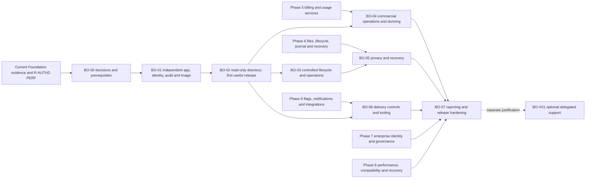

# Backoffice development plan

Status: **planned; no implementation accepted**, 2026-09-27. Scope and priorities: [brief](../../feature-briefs/backoffice.md). Source inventory, proposed ADRs and technical contracts: [architecture](architecture.md). All acceptance IDs and their status are owned by the [roadmap](../06-delivery-roadmap.md#67-backoffice-planned-delivery-and-acceptance); tables here decompose work and specify evidence, not a second sign-off register.

## Prerequisites and release sequence

This is an overlay on existing Phases 5–8, not a replacement roadmap or a second implementation of their services. It pulls the minimal operator boundary/read UI forward from Phase 7, builds commercial administration with Phase 5, privacy and delivery controls with Phase 6, and closes enterprise/hardening requirements with Phases 7–8. Customer deployments may omit Backoffice completely.

| Dependency | Verified repository state | Required action |
| --- | --- | --- |
| Foundation M1 | Open; Phase 4 recorded local `R-SKILLS` under a specific exception | BO-00.2 obtains current evidence and resolves outstanding applicable gates before the production-capable BO-01 implementation track. This plan grants no new exception |
| `R-AUTHZ-PERF` | Pending full `direct-project-v1`; removal brief records only passing smoke | Run the current stable ≥30-minute gate as separate implementation work, retain failures and exact fingerprint; do not rerun it in this documentation task |
| Current images/security | Historical results precede later changes; no new results claimed | Rebuild/scan/test affected current customer image with BO-01; previous image digest does not validate the new pair |
| Platform operator primitives | Only independent signed CLI recovery/deactivation implemented | New principals, roles, identity tables, scoped query/command entry points, audit and operator model are BO-01–03 work |
| Billing/provider/usage | Phase 5 planned | BO-04 depends on real Phase 5 billing ledger/commands/inbox/reconciliation; no facade over installed Stripe package |
| Export/deletion/restore | Phase 6 planned; independent readiness alone exists | BO-05 jointly implements/reuses Phase 6 services and passes existing lifecycle gates before exposing execution |
| Flags/messages/integrations/analytics | Phase 6 planned | BO-06 builds shared delivery/evaluator/adapters once; BO-07 needs confirmed financial facts and declared analytics sources |
| Enterprise SSO/support/holds | Phase 7 planned | Minimum deletion hold checks cannot wait; corporate SSO may become initial policy prerequisite; optional support access stays off |

BO-00 design and source inventory can proceed while the performance prerequisite is unresolved. Its architecture gate can be reviewed independently; its prerequisite work item remains open until evidenced. BO-01 does not inherit Phase 4's historical bypass. If a future owner wants a development-only exception, it must be separately documented with scope/expiry and cannot mark M1 or any performance gate passed.

The earliest useful internal release is BO-00–02: private sign-in, masked global organization/account directories, current local seats/entitlements and audit/diagnostic history. No Stripe/help desk/analytics credentials are needed. BO-03 security operations and BO-06 flags/messages can also arrive before commercial modules if their own shared services pass. Financial panels stay absent until BO-04; privacy intake may be piloted manually, but export/deletion fulfillment cannot pass BO-05 without the actual services.

## Common implementation and evidence contract

Use the [actual source map](../development/feature-workflow.md) and relevant repository skills for each implementation slice. Inspect customizations and applied migrations on resume. All new tables/events/exports require independent input, read, filter/search, audit and export allowlists; strict DTOs never serialize database rows wholesale. Future schema names below are proposals, not migrations created by this task.

For every phase, retain a manifest under `artifacts/backoffice/<phase>/<run-id>/` with commit plus dirty-source fingerprint, migration/model/contract versions, enabled modules, commands/exit codes, fixture parameters, server/tool versions, image digests/architectures, test names and failure diagnostics. Commit a concise phase acceptance record and link it from the canonical roadmap only after checks run. Preserve failures, skipped/missing prerequisites and hosted-versus-local distinctions. No permissive provider stubs, UI placeholders or smoke benchmarks satisfy shipping acceptance.

Use unit tests for policy/state/formula logic; restricted-role PostgreSQL and real FGA for authorization/lifecycle/audit/races; Playwright on both separate hosts for cookies/origins and complete UI states; image tests for actual process/route/asset/secret isolation. Synthetic provider adapters must faithfully exercise failure and replay; selected provider sandbox verification is an additional release gate, not replaced by unit tests. Ordinary CI needs no production credentials, live customer data or paid AI agent. Apply [verification](../development/verification.md), source/type/Knip, frozen install, immutable migration checks and [vulnerability policy](../../security/README.md) as relevant.

Measurable budgets proposed for BO-00 ratification: pages ≤50 rows, bounded scan ≤200 candidates, no unrestricted totals; default query timeout 2 seconds/lock wait 250 ms for directory/reporting reads, pool ≤4 per BO web replica initially, fixture load 10 simultaneous operators across 10,000 organizations/100,000 account projections. Directory p95 ≤1 second at that workload, with zero scope leaks and recorded first-attempt failures. Report/export processing has independent concurrency budgets; customer workload must still meet its unchanged canonical targets. These are acceptance targets to measure, not achieved benchmarks; tuning cannot relax existing `R-AUTHZ-PERF` targets.

Every phase below inherits the architecture's command/audit/lock/readiness/expiry contract and its explicit failure states. Each exit requires all due canonical gates, accepted security review and retained evidence on the phase's final stable source. Binary rollback must honor the release compatibility manifest; schema rollback is never assumed.

## BO-00 — Architecture, contracts and prerequisites

Objective: agree scope, trust boundaries and delivery changes before adding privileged code. User-visible outcome is an approved plan, capability contract and first slice; no application behavior. Exclude application code, migrations, dependency installation and infrastructure provisioning from the present task.

| Work ID | Work package / likely locations | Deliverable |
| --- | --- | --- |
| BO-00.1 | `feature-briefs/backoffice.md`, `docs/backoffice/architecture.md`; product/security workshop | Ratify ADRs, role/action matrix, operator schema versus private API choice, threat owners and initial release scope |
| BO-00.2 | Existing Phase 3/4 acceptance and `scripts/phase3/benchmark.ts`, under a subsequent implementation task | Close applicable Foundation prerequisites with current evidence; maintain explicit pending state until then |
| BO-00.3 | Contract-amendment table in architecture; later edits to docs 00/01/02/03/04/07 and AGENTS | Review exact two-image, principal/model, operator-fence and queue/version compatibility changes |
| BO-00.4 | `docs/backoffice` evidence/decision records | Ratify numeric budgets, staff enrollment/offboarding and emergency authority, data inventory classification, release/retention owners |

Schema/API/event/job/config/image changes: none in this task. Specify their future ownership and compatibility constraints; no approval signing keys are generated or deployed. Security/privacy review must explicitly consider a compromised BO process with restricted application DB access and the optional internal API alternative.

Acceptance/evidence: `R-BO-ARCH` requires source-linked inventory, every brief requirement mapped, all consequential unknowns owned, reviewed diagrams/ADRs and exact amendment list. BO-00.2 independently records the current performance/other prerequisites; a document review cannot pass a benchmark. Exit to BO-01 requires both architecture review and prerequisite closure. Rollout/rollback: documentation changes are reviewable and reversible; never rewrite historical acceptance or retire stable IDs. Estimate **1–2 engineer-weeks**, excluding unknown work to fix a failing Foundation gate; architecture/security and provider feasibility review can run concurrently.

## BO-01 — Independent application, operator access and audit

Objective: a production-shaped private operator shell with its own lifecycle. Outcomes: invited staff sign in with MFA, see their access/own audit, and can be offboarded immediately; separate image starts without customer auth credentials. Exclude customer data search, tenant mutations, provider operations and support delegation.

Dependencies: BO-00 and approved identity/network policy; existing config/UI/auth helpers, real PostgreSQL/FGA and independent readiness. No commercial modules required. SSO becomes an explicit dependency if corporate policy forbids local staff credentials.

| Work ID | Work package / likely locations | Concrete changes |
| --- | --- | --- |
| BO-01.1 | `apps/backoffice`, `packages/backoffice-contracts`, `packages/backoffice` | Localized shell, private operator RPC/auth routes, runtime composition, strict errors/DTOs and deny-by-default capability catalogue |
| BO-01.2 | `packages/auth/src/operator`, `packages/authz/src/platform`, `packages/db/src/backoffice` | Separate identity/session tables, invite-only enrollment, passkey/step-up/offboarding; scoped assignment/revision tables and independent operator model/publication; no customer role linking |
| BO-01.3 | `packages/backoffice/src/audit`, new reviewed DB migration | Append-only read/mutation/approval/denial audit and scoped query; separate denial transaction; no personal payloads |
| BO-01.4 | `packages/config/src/backoffice.ts`, BO request boundary, deployment runbook | Distinct keys/origin/RP/cookies, verified ingress and CIDRs, offboarding/allowlist change and emergency workflows; production deny without approved network proof |
| BO-01.5 | `infra/docker/Dockerfile`, `infra/docker/backoffice`, `scripts/backoffice`, root scripts/Turbo/Knip/CI | Independent build/target/image/version and startup validation, pruning proof, standalone assets, health/signals, source/route/bundle exclusion and image matrix |
| BO-01.6 | `packages/testing`, isolated browser/image suites, existing docs contract amendments | Synthetic enrollment/approval fixtures, predecessor schema migration tests, compatibility manifest and current customer regression evidence |

Schema: new operator identity/assignment/session/audit schema and dedicated roles, reviewed incremental app migration plus separately reviewed control publication extension. Preserve applied history and default customer behavior. API/events: versioned operator session/access DTOs and payload-free enrollment/revocation/audit records. Jobs: none required for web health; use bounded cleanup under explicit retention credentials, not a required BO worker. Config/image changes are those in the architecture's delivery contract; all proposed commands become real only in this implementation phase.

Security/privacy: enforce server-side freshness/current policy on every entry point, including server rendering and downloads; role/network changes cannot self-approve. Application restore invalidates BO credentials and assignments alongside customer state. Until Phase 6 release recovery exists, restored installations remain closed; an internal read-only release does not authorize an ad hoc restore reset.

Acceptance/tests: `R-BO-ACCESS`, `R-BO-NETWORK`, `R-BO-AUDIT`, initial `R-BO-IMAGE` and `R-BO-COMPAT`. Prove customer cookie/API key/forged operator field denied; wrong RP/origin/CSRF denied; operator offboarding racing a read or mutation drains prior operations and denies later ones; early-batch/session/approval expiry prevents commit. Test FGA/control/audit loss, spoofed IPv4/IPv6 headers, invalid proof and direct origin, deny self-grant/self-approval and wrong-environment credentials. Image acceptance proves non-root, native libraries, no secrets/build services, assets, health, SIGTERM and no operator HTTP route in customer image.

Evidence/exit: real-role/FGA results, browser isolation traces, route/bundle manifests, role grants, both scanned image digests and a lockout-recovery exercise. No unresolved critical/high findings except exact reviewed policy exceptions. Rollout: additive schemas first; deploy private BO dark to synthetic staff, then named staff cohort. Rollback BO image/ingress without changing customer deployment; retain audit/assignment history, revoke sessions if auth changed. Estimate **5–8 engineer-weeks**; identity/policy work and packaging/CI can run in parallel after contracts freeze. Separate-adapter friction or mandatory IdP increases uncertainty.

## BO-02 — Read-only organization and account administration

Objective: the first useful internal release. Outcomes: bounded directories, masked details, scoped reveals, local seats/entitlements, lifecycle/recovery status, sanitized audit/job/mail history. Exclude all tenant mutations, financial projections not yet implemented, business-record browsing and exports.

Dependencies: BO-01 and source-reviewed tenancy/identity projections. Current customer-authored `example_customers` is explicitly out of scope. Freshness indicators are mandatory; stale projected membership/lifecycle does not authorize an action.

| Work ID | Work package / likely locations | Concrete changes |
| --- | --- | --- |
| BO-02.1 | `packages/db/src/backoffice/directory`, `packages/backoffice/src/queries`, `apps/backoffice/src/features/organizations` | Exact-ID first slice, then indexed masked directory, stable actor/scope/query-bound encrypted cursors, allowlisted filters and page limits |
| BO-02.2 | `packages/auth` identity projection entry point, BO accounts/membership views | Separate global-account grant, keyed exact-email lookup, safe organization detail/owner projections, independent reveal permission and audited short-lived disclosure |
| BO-02.3 | Domain event adapters, BO detail panels | Local entitlements/seat sources, readiness/owner-recovery status and source watermark; register commercial panels only with real services |
| BO-02.4 | Audit queries and `apps/worker`/mail diagnostic read adapters | Redacted operation IDs, fixed failures, attempts/lag; no auth URL, body or raw queue payload |
| BO-02.5 | `scripts/backoffice` tests, Playwright and stories | Scope/filter/cursor/field leakage, keyboard/locale and customer-outage acceptance for first internal release |

Schema: minimal registry projections and indexes, source revision/watermark, purpose-separated identity lookup digest; scoped disclosure receipts. No copied credential rows. API/events/jobs: list/detail/reveal queries plus versioned projection updates, idempotent bounded backfill/reconciliation consumer; BO worker mode may be introduced for these projections, independently deployed from web. Config: separate projection role/key and bounded pool/timeouts. Image: add only required worker closure; web readiness must not depend on worker heartbeat when safe stale reads can be labeled or denied.

Security/privacy: explicit global versus org account fields; no totals over inaccessible data, personal query text in logs, or cache reuse across operators/scopes. Preserve no-store on sensitive responses. Current scope and independent readiness gate disclosure even when projection is stale; paused/deleting records use diagnostic-only permissions.

Acceptance/tests: `R-BO-DIRECTORY`, plus affected access/audit/image gates. Prove two tenants with an overlapping account cannot expose unrelated memberships, wrong-scope empty/error responses conceal restricted content, forged/query-changed/expired cursors deny, and reveal/export permissions differ. Mask fields at API output, not just CSS. Projection duplicate/out-of-order events reconcile without resurrecting deleted entries; audit failure returns no bytes. Meet ratified directory budgets under the declared dataset and customer load.

Evidence/exit: synthetic directory fixtures, field/role matrix tests, query plans and measured bounds, localized browser journeys, customer outage/isolation suite and both image reports. First internal release is accepted only when BO-00–02 due gates and Foundation prerequisites are recorded. Rollout: staff pilot with scoped org sets; widen grants after audit review. Rollback removes BO routes/deployment; projections are disposable and suppression-aware, audit retained. Estimate **3–5 engineer-weeks**, directory/backend and UI can proceed in parallel once DTOs are fixed.

## BO-03 — Controlled lifecycle and operations commands

Objective: remove manual database changes for narrowly defined operational actions. Outcomes: suspension/reactivation requests, session revocation, recovery cases, incident containment and controlled replay of registered safe consumers. Exclude deletions, arbitrary role edits, financial commands and direct signed-recovery execution from web.

Dependencies: BO-02; Phase 2 lifecycle/seat services; new domain suspension/global-account controls require explicit implementation as Phase 6/7 precursors, not an existing API assumption. Offboarding/recovery authority remains independent.

| Work ID | Work package / likely locations | Concrete changes |
| --- | --- | --- |
| BO-03.1 | `packages/backoffice/src/commands`, contracts and DB metadata | Preview/hash/version/approval/receipt state machine with single-use consumption, per-target idempotency and time-bounded scoped grants |
| BO-03.2 | `packages/db/src/tenancy.ts`, `packages/auth` lifecycle service | Explicit operator suspend/reactivate/revoke entry points sharing invariant-preserving internals; separate suspension causes, optimistic versions and current seat admission |
| BO-03.3 | BO recovery case UI and narrow control receipt reader | Prepare exact case/target/evidence and show externally executed signed command status; no signer/admin secrets in BO |
| BO-03.4 | Domain dispatcher adapters / BO operational UI | Registry of safe replays, named queue pause/resume, immutable bounded bulk manifests and per-item reconciliation |

Schema: command/preview/approval/attempt/bulk-item tables, cause-specific lifecycle state if absent, expected versions and immutable domain receipts. API/events: action-specific request/preview/approve/execute/status/cancel; allowlisted audit/outbox. Jobs: explicit domain executors for approved effects; no generic “run function” payload. Workload authorization may read a minimal grant/mandate projection but receives no operator login, signing or customer identity credential secrets. Config/image: executor capability allowlist, command expiry/limits, per-queue concurrency; images declare command version compatibility.

Security/privacy: use the [operator protocol](architecture.md#operator-command-protocol) and canonical locks/expiry. Global account freeze names all affected organizations and uses user-fence-first domain semantics. Reactivation retains other suspension/deletion/recovery causes and never recreates revoked credentials. Existing security deactivation preserves independent signature/MFA even during FGA outage; no generic approval can authorize it.

Acceptance/tests: `R-BO-LIFECYCLE` and initial `R-BO-OPS`, extending `R-LIFECYCLE`, `R-SEATS`, `R-OWNER`, `R-AUTHZ`. Race two requesters at expected version; invite versus reactivation for last seat; freeze versus new membership; suspension versus resource update; replay after role/MFA expiry; commit then control acknowledgement loss. Assert one state/seat/audit effect and no resurrection. Recovery UI cannot execute unsigned/stale/wrong-epoch envelopes or release readiness. Bulk cap/changed target/partial completion/cancel-before-dispatch and unsafe consumer denial are required.

Evidence/exit: real-service concurrent traces/receipts, dry-run and escalation walkthrough, domain regression suites and revised threat review. Rollout: enable session revocation/suspension first for security staff; dual-approved reactivation and bounded replay next. Rollback disables new commands/queue intake; accepted obligations continue under fixed mandates or reconcile—never delete receipts. Estimate **4–7 engineer-weeks**, with lifecycle/global-account model uncertainty; command UX and replay adapters can run in parallel after state-machine review.

## BO-04 — Billing operations and dunning

Objective: finance can inspect and safely request commercial changes. Outcomes: full commercial timeline, previews, approved plan/trial/discount/contract actions, refund/credit/cancel requests, dunning/escalation and reconciliation. Exclude custom accounting, card storage, automatic dispute submissions and optional metered-provider contracts.

Dependencies: BO-02 plus BO-03.1 command contract; Phase 5 billing accounts/catalogue/immutable sold versions/subscriptions/invoices/provider inbox/commands, local usage ledger and entitlement projection. BO may develop against a contract test adapter, but release requires real Phase 5/provider evidence. The bounded effective/expiring override service is explicitly pulled forward from Phase 7; full negotiated-contract lifecycle stays Phase 7.

| Work ID | Work package / likely locations | Concrete changes |
| --- | --- | --- |
| BO-04.1 | Phase 5 billing service public queries; BO finance views | Distinct provider, sold-plan, local entitlement, seat/usage, invoice/payment and manual-contract status with freshness/reconciliation |
| BO-04.2 | Phase 5 commands/adapter, BO preview/approval UI | Preview plan/price/quantity/effective/proration and trial/discount limits; approved capped overrides with expiry; one invoicing owner |
| BO-04.3 | Billing adjustment/reconciliation service | Refund/credit/cancel with remaining amount and current provider state, serial commands and ambiguous-result reconciliation; disputes metadata/deep links |
| BO-04.4 | Phase 5 dunning service, domain worker, notification ownership | Delinquency episode/invoice queue, provider-owned retry status, application grace/escalation and deduped notice assignment |
| BO-04.5 | Provider adapter tests and finance fixtures | Pinned API/event compatibility, currencies/rounding/proration, outage/replay/seat race and finance approval evidence |

Schema belongs to Phase 5, following [billing logical model](../03-data-model.md#35-billing-entitlements-and-usage-tables): no separate BO subscription table. Add only case/approval/reconciliation UI metadata and domain dunning episodes/notice receipts where absent. API/events/jobs: typed billing commands/status/preview, verified provider inbox once, serialized subscription processing, outstanding-command sweeper and provider reconciliation. Config/image: selected provider/version and queue credentials in domain worker/ingress; BO web has no general provider write key. Signed webhooks remain independently reachable while BO is offline.

Security/privacy: separate finance read/request/approval powers, reason and currency ceilings, new approval after changed preview, no card/payment secrets. No new paid entitlement/capacity from a requested change alone. Provider downgrades record over-capacity and block positive admission without removing staff. Dunning grace, manual contract and security suspension are independent causes; a paid invoice cannot clear a security freeze.

Acceptance/tests: `R-BO-BILLING`, `R-BO-DUNNING`, Phase 5 lifecycle gates and `R-POLICY`/`R-SEATS`. Deliver duplicate/out-of-order/missed webhook events, unknown provider mapping, portal change racing operator command, timeout after provider success, expired quote, discount/trial boundary, invoice partially refunded twice and different-currency amount. One semantic charge/adjustment, exact current entitlement source and honest pending status. Provider outage never schedules competing retries; duplicate payment-failed events send at most one application notice per declared notice key, with actual SMTP at-least-once limitation visible. Grace expiry racing payment/reconciliation converges to current authoritative access policy.

Evidence/exit: deterministic fixtures, selected provider sandbox receipts/versions, financial reconciliation report with zero unexplained test differences and finance approval of policy/UX. No hypothetical provider capability is accepted. Rollout: read-only finance view, sandbox commands, then named approved production cohort with per-currency ceilings; disable new BO submissions without disabling provider ingress/domain reconciliation. Rollback uses compensating approved commands; financial history is append-only. Estimate **4–7 incremental engineer-weeks**, excluding Phase 5's underlying services; finance UI, adapter proofs and dunning can run in parallel after ownership contracts freeze.

## BO-05 — Privacy exports, deletion and recovery integration

Objective: privacy staff can manage requests and evidence through safe, resumable fulfillment. Outcomes: verified cases/deadlines, scoped exports, org/account deletion progress, retention exceptions and restore suppression. Exclude any claim of legal certification, unverified requester fulfillment, generic database export or automatic restore reopening.

Dependencies: BO-03; Phase 6 file/export inventory, account/org lifecycle, independent journal/complete replay and recovery services. Basic retention/hold policy is mandatory here; advanced Phase 7 legal-hold administration may follow. Phase 5 settlement is required only for installations with commercial billing; Foundation/no-provider case uses genuine local policy, not fake cancellation receipts.

| Work ID | Work package / likely locations | Concrete changes |
| --- | --- | --- |
| BO-05.1 | Phase 6 privacy service / BO case UI | Intake, verify requester/representative, scope/rights review, assignment, policy-versioned deadlines/extensions and response evidence |
| BO-05.2 | Phase 6 inventory/export service, storage adapter, domain workers | Separate org and subject export selectors, redaction/manifest, resumable encrypted generation, expiry and authenticated audited delivery |
| BO-05.3 | Phase 6 account/org deletion services and independent control | Dry-run impact, exact confirmation/approval, owner continuity, holds/cancellation, journal ack, bounded cleanup and provider settlement status |
| BO-05.4 | Recovery commands/runbook and BO diagnostics | Journal watermark/evidence view, restored-data suppression and independently authorized revalidation; no BO readiness-release button |
| BO-05.5 | Cross-module deletion registry / real-service recovery tests | Inventory every enabled store/provider, prove deletion/replay/late-write barriers and honest complete/retained/provider-pending states |

Schema: Phase 6 owns privacy requests, subject/org steps, export manifests, retention decisions, provider receipts and independent journal; BO stores presentation/work assignment only where not already owned. Database and independent control migrations have separate authorities. API/events/jobs: typed preview/confirm/status, subject-specific export, receipt-bound download, journal reconciliation and named cleanup tasks with immutable mandates. Config/image: private storage/export keys and purge roles restricted to domain executors; BO web has no bucket-wide deletion or control-admin credential. Customer optional export/download endpoints must be delivered and tested with Phase 6, including users whose account is frozen.

Security/privacy: adhere to [canonical lifecycle/recovery](../04-billing-usage-operations.md#48-export-deletion-and-recovery-lifecycle). Export actual registered data only; unknown enabled module blocks a “complete” manifest. Legal holds cannot be removed by a purge executor. Account deletion preserves other tenants and their billing; accepted ownership transfer is not rolled back on abandoned request. Expiring download authorization checks recipient/current scope and immutable bytes. Retained journal identifiers cover all supported backups; old copies are suppressed before serving, not declared physically erased prematurely.

Acceptance/tests: `R-BO-PRIVACY` plus `R-FILES`, `R-ORG-DATA`, `R-ACCOUNT`, `R-RECOVERY`, `R-LIFECYCLE`. Cross-subject redaction, revoked/expired recipient, source changed mid-export, malicious object/key substitution, partial bytes/cancel and download audit failure. Two-org user with last ownership obligations, deleted successor, new membership during freeze, duplicate seat release, journal outage after intent, cancel before/after purge, provider timeout and delayed analytics/help desk writes. Restore a pre-deletion/pre-revocation snapshot with mismatched FGA, missing journal watermark and restored credentials: no deleted data/access returns, unresolved orgs stay closed. Show `provider_pending` and `complete_with_retention` truthfully.

Evidence/exit: legal-approved data/retention/clock policy, real-service crash/restart and restore drill, export coverage/redaction manifest, provider cleanup/suppression receipts for enabled adapters and privacy response walkthrough. No skipped enabled store. Rollout: case management first; exports next; deletion only after journal/recovery gates pass. Rollback stops unaccepted work; accepted journaled cleanup continues or remains visibly pending. No destructive down migration, account unfreeze or snapshot restore as a cancellation mechanism. Estimate **5–9 incremental engineer-weeks** excluding shared Phase 6 prerequisites; export and case UX can run alongside journal implementation, but purge acceptance is on the recovery critical path.

## BO-06 — Flags, messaging, help desk and operational tooling

Objective: operators can safely publish rollouts/communications and diagnose integrations. Outcomes: controlled flags, targeted localized messages, verified support links/ticket metadata, safe replay and incident/bulk tooling. Exclude arbitrary scripts/HTML, full marketing/ticketing replacement, bulk money movement or bulk purge.

Dependencies: BO-02 and BO-03.1 for approvals; Phase 6 shared flags/notifications/preferences/integrations services, implemented once for both apps. BO-03.4 for mutation replay. Billing-independent controls can ship before BO-04. Provider credential scopes/retention and message preference classification require owner review.

| Work ID | Work package / likely locations | Concrete changes |
| --- | --- | --- |
| BO-06.1 | Phase 6 flag service/evaluator, BO authoring, customer runtime | Rule/segment versions, deterministic bucketing, effective/expiry times, publish/rollback and independent emergency off |
| BO-06.2 | Phase 6 messaging/preferences, `apps/web` rendering and BO preview | Typed content/locales, review/schedule/dismissal/frequency, segment snapshot and safe customer components/query |
| BO-06.3 | Phase 6 integrations adapter, BO help desk UI/worker | Verified identity mapping/deep links, bounded cached ticket metadata, optional verified provider webhook, rate-limit/outage/deletion handling |
| BO-06.4 | Domain diagnostics/replay registry and BO operations pages | Job/outbox/inbox/email history, dead-letter safe inspection, reconciliation requests and bounded incident/bulk workflow |

Schema: shared versioned flag/rule/segment/message/preference/dismissal tables under their domain owner; provider mapping/cache and delivery receipts; stable batch item receipts. API/events/jobs: publish/revoke rules/messages with sequence, bounded consumer refresh and invalidation, help desk sync and suppression, replay through registered command adapters. Config/image: operator authoring separately enabled, customer evaluator/rendering can operate with no BO credentials; adapter secrets only in sync/domain workers. Published schemas and defaults declare old/new customer compatibility.

Security/privacy: flags never authorize or sell a feature. No segmentation by unapproved sensitive attributes. Message content cannot execute code or target arbitrary DOM; reviewer sees effective audience/locales/links. Provider account IDs and external links are validated against stored mappings, not input email. All new provider data participates in deletion/retention before adapter acceptance; diagnostics never expose encrypted mail payloads.

Acceptance/tests: `R-BO-FLAGS`, `R-BO-MESSAGING`, `R-BO-HELPDESK`, `R-BO-OPS`. Same flag/org/env/version yields identical bucket in web/worker; percentages, boundaries, expiry, stale cache and rollback correct; healthy propagation meets ≤30s p95/60s max proposed budget. Stop BO completely: customer defaults/last valid state remain safe and authorization unchanged. Messages cover timezone scheduling, missing locale, preference revocation before delivery, per-user/org dismissal isolation, duplicate deliveries, XSS/link injection and withdrawal. Help desk covers collision/wrong-org mapping, expired credentials, 429/retry headers, stale cache, signature replay, provider outage and deletion followed by late sync. Bulk changed versions and revocations yield per-item conflicts, never unbounded retries.

Evidence/exit: deterministic evaluator fixtures, real customer-render/browser and image-outage results, one selected adapter sandbox proof, source/retention mapping, measured propagation and queue budget. Each submodule may release separately only after its gate; “disabled” is not “passed.” Rollout: flags with internal orgs, messages with approved staff fixtures, help desk read-only, then registered safe replay. Rollback publishes new version/safe defaults and stops authoring; current customer reader compatibility must remain. Estimate **5–9 engineer-weeks** for BO integration and explicitly required customer surfaces, excluding shared Phase 6 service construction; flag/messaging/help desk lanes are parallelizable.

## BO-07 — Reporting, enterprise access and release hardening

Objective: trustworthy business health and proven independent operations across deployment/recovery scenarios. Outcomes: reconciled finance metrics and honest missing-data indicators, mature access review/SSO where enabled, bounded reporting, tested dual-image release/rollback. Exclude accounting certification, speculative warehouse adoption and unjustified support impersonation.

Dependencies: BO-04 for financial reports; Phase 6 analytics for behavioral reports; BO-05/06 for all-enabled release hardening; existing Phases 7/8 enterprise policy and recovery requirements. Reporting schema/formula work can begin in parallel once billing facts are stable. CAC/LTV source gaps remain visible release limitations, not invented values.

| Work ID | Work package / likely locations | Concrete changes |
| --- | --- | --- |
| BO-07.1 | `packages/db/src/reporting` or actual Phase 6 report service; BO reports | Versioned metric definitions/projections, finance reconciliation, source watermarks, cohorts/currencies/refunds and cost-input validation |
| BO-07.2 | Reporting worker/query role and performance harness | Bounded incremental/backfill jobs, rollup indexes, query limits, simultaneous customer/operator/export load; replica extraction only if measured need |
| BO-07.3 | Phase 8 CI/image/recovery harness, release manifests/runbooks | Supported version-pair matrix, additive/breaking migration drills, independent rollback, outages, scans/provenance and operational recovery evidence |
| BO-07.4 | Operator identity adapter and access-review UI, Phase 7 | Corporate SSO/deprovisioning if selected, periodic grant review, legal-hold extension integration and independent emergency drill; no new customer IdP privileges |

Schema/API/events/jobs: reporting facts/rollups with definition/currency/cohort/watermark keys, minimal cost/attribution inputs with provenance, restricted report queries and scheduled reconciliation. SSO adds explicit issuer/subject mapping and offboarding receipts. Config/image: reporting pool/rate limits and provider/FX source settings; per-image compatibility manifests, signed provenance on trusted releases, performance/evidence jobs. No new microservice or reporting database without a measured/security decision.

Security/privacy: current report scope, small-cohort suppression where individuals could be exposed, no customer content properties, deletion-aware backfills. Counts/reports remain privileged reads. No bypass for auditors; exports use the existing audited export boundary. SSO recovery cannot reactivate a disabled operator automatically; verify corporate offboarding and session invalidation.

Acceptance/tests: `R-BO-REPORTING`, `R-BO-COMPAT`, `R-BO-RELEASE` and applicable existing Phase 8 image/performance/recovery gates. Fixtures cover monthly/annual pricing, recurring/nonrecurring discounts, refund/credit/dispute, partial recovery, plan migration, FX restatement, immature cohort, duplicate fact, zero denominator, missing cost and deletion. Reconcile every fixture's recurring bridge and cash adjustments to source, with no unexplained difference. Meet ≤15-minute proposed report freshness under stated load, preserve canonical customer performance targets, test query timeout/fairness and corrupt/missing watermarks.

Evidence/exit: finance-approved versioned formulas and fixture totals, concurrent-load reports, every supported customer/BO version pair on actual images, independent disablement/rollback drills, all enabled-module recovery evidence, accessibility review, security review and exact scans/provenance. Every required BO gate must be accepted in the roadmap; disabled optional support/SSO/provider adapters are documented as not enabled. This gate cannot close outstanding M1 or Phase 8 work by assertion.

Rollout: shadow reports against finance extracts, display reconciliation differences, then operator sign-off; enterprise SSO staged enrollment before retiring old access. Rollback report readers/projections within schema compatibility; preserve finance/audit histories. Breaking model/schema upgrades use the established maintenance procedure; no destructive down migration. Estimate **4–7 engineer-weeks**, plus **2–4** if corporate SSO integration is selected and not already delivered; costs/attribution cleanup and performance remediations are uncertain and separately estimated after measurement.

## BO-X01 — Optional delegated support decision

Default: **do not implement or enable**. Current requirements are satisfied through metadata, diagnostics and scoped privacy export. Reconsider only with evidence that those mechanisms cannot solve recurring support cases. No estimate is included in the baseline. A future decision must budget design and implementation separately rather than claim this plan ships support access.

If approved, add an explicit time-bound support principal with actual operator identity, tenant-approved or independently incident-approved scope, visible customer-session indicator and immutable action log. Read-only registered resources first; deny billing, identity/security, exports/deletion, secrets and impersonated writes by default. No minted customer session or invisible effective actor. Tenant resource policy/model/compiler must support the exact delegated actions and current revocation; existing customer membership is never fabricated. `R-BO-SUPPORT` requires consent/approval, expiry/revocation-through-commit, multi-tenant isolation, customer notification policy, read audit and outage evidence before enabling. Rollback revokes every support grant/session and keeps audit.

## Effort, critical path and parallel delivery

All estimates are **incremental engineer-weeks**, including design implementation, review and meaningful tests, for engineers familiar with the repository. They assume stable existing services, one billing/help desk adapter, no data residency migration, synthetic test infrastructure and ordinary review availability. They are ranges, not dates or person-count commitments.

| Phase | Incremental estimate | Largest uncertainty |
| --- | --- | --- |
| BO-00 | 1–2 | Security decisions and unresolved Foundation remediation (excluded) |
| BO-01 | 5–8 | Separate identity adapter, operator policy publication and ingress proof |
| BO-02 | 3–5 | Safe global directory projection and scope/search cost |
| BO-03 | 4–7 | New suspension/global-account service semantics and replay ownership |
| BO-04 | 4–7 | Provider previews/adjustments and finance policy; Phase 5 base excluded |
| BO-05 | 5–9 | Data inventory/providers and recovery; Phase 6 base excluded |
| BO-06 | 5–9 | Customer rendering, preference and integration contracts; shared Phase 6 base excluded |
| BO-07 | 4–7 | Financial inputs, compatibility/performance and release hardening |
| Optional corporate SSO increment | 2–4 | IdP/pinned adapter proof; do not count twice if Phase 7 supplies it |

Base incremental total: **31–54 engineer-weeks**, plus required but undelivered Phase 5–8 service work and any Foundation remediation. BO-00–02 is **9–15 engineer-weeks** after prerequisites, excluding mandatory SSO if policy selects it. Do not add these mechanically to old roadmap totals: a planning pass must assign each shared service exactly once. Especially journal/recovery, billing commands, notification preferences, flags and integrations are existing roadmap deliverables; estimates above cover additional operator entry points/surfaces and explicitly identified customer integration, not duplicate service builds.

Critical path to the first release: current Foundation acceptance → operator identity/policy and audit → private image/ingress → safe directory. Critical path to privacy release: independent journal/recovery and data inventory → verified export/deletion services → BO confirmation/execution/status. Full release is the longest of privacy/recovery, billing/provider reconciliation and shared delivery controls, followed by all-enabled compatibility/performance hardening. Reporting can run beside privacy once confirmed billing facts exist; CAC/LTV depends on external organizational data, not more UI work.

Parallel opportunities are future engineering lanes, not subagents spawned for this documentation task: packaging/CI alongside identity after ADR agreement; directory UI alongside bounded DTO/query development; finance adapter/dunning alongside privacy inventory; flags/messages/help desk separately after shared publisher contracts. Avoid simultaneous incompatible changes to applied migration order, canonical locks or pinned models; designate one migration/model owner and integrate reviewed additive work frequently.

## Requirement traceability

Requirement `C-*` definitions are in the [brief](../../feature-briefs/backoffice.md#capability-and-priority-matrix). Gates below link to the single [canonical register](../06-delivery-roadmap.md#backoffice-acceptance-register); existing `R-*` contracts remain cumulative, not superseded.

| Requirement | Work items | Acceptance gate(s) |
| --- | --- | --- |
| Independent app/build/config/start/version/hostname/image; optional to customer | BO-00.3, BO-01.1/.5/.6, BO-07.3 | R-BO-ARCH, R-BO-IMAGE, R-BO-COMPAT, R-BO-RELEASE; R-IMAGE |
| C-01 separate operators, enrollment/offboarding, MFA/step-up; customer roles never operators | BO-01.2/.4 | R-BO-ACCESS; R-AUTHZ, R-LIFECYCLE |
| Corporate CIDRs/VPN, IPv4/IPv6, trusted proxies/direct origin, lockout/emergency access | BO-01.4, BO-07.4 | R-BO-NETWORK, R-BO-ACCESS |
| C-02/03 organization/global account/membership search and detail; business-record distinction | BO-02.1/.2/.3 | R-BO-DIRECTORY; R-TENANCY |
| C-04 sensitive masks, reveals and independent export scope | BO-02.2, BO-05.2 | R-BO-DIRECTORY, R-BO-PRIVACY, R-BO-AUDIT |
| C-05 suspension/reactivation/session revocation and recovery | BO-03.1/.2/.3 | R-BO-LIFECYCLE; R-OWNER, R-SEATS, R-RECOVERY where applicable |
| C-06 plans/subscriptions/trials/invoices/payments/credits/discounts/seats/usage | BO-04.1 | R-BO-BILLING; Phase 5 lifecycle gates |
| C-07 plan/trial/discount and bounded contract override; preview/effective/proration/expiry | BO-04.2/.5 | R-BO-BILLING; R-POLICY, R-SEATS |
| C-08 refund/credit/cancel/dispute, no duplicate charge, provider confirmation | BO-04.3/.5 | R-BO-BILLING |
| C-09 dunning queue/reminders/retries/grace/escalation/recovery, single retry owner | BO-04.4/.5 | R-BO-DUNNING, R-BO-REPORTING |
| C-10 privacy intake/verification/scope/assignment/deadline/evidence | BO-05.1 | R-BO-PRIVACY |
| C-11 org vs subject exports, inventory/redaction/encryption/expiry/download audit | BO-05.2/.5 | R-BO-PRIVACY; R-FILES, R-ORG-DATA |
| C-12 org vs multi-org account deletion, preview/confirmation/approval/retention/cancel | BO-05.3/.5 | R-BO-PRIVACY; R-ACCOUNT, R-ORG-DATA, R-LIFECYCLE |
| All stores/providers/backups/restores; independent journal and honest completion | BO-05.4/.5, BO-07.3 | R-BO-PRIVACY, R-BO-RELEASE; R-RECOVERY |
| C-13 flags/segments/percentages/schedule/expiry/rollback/emergency; no auth/entitlement coupling | BO-06.1 | R-BO-FLAGS; R-POLICY |
| C-14 messages/walkthrough triggers, review/locales/preferences/dismiss/frequency/safety/customer changes | BO-06.2 | R-BO-MESSAGING, R-BO-IMAGE |
| C-15 help desk links/summary/mapping/credentials/signatures/rate limits/outage/deletion/adapters | BO-06.3 | R-BO-HELPDESK; R-BO-PRIVACY for enabled adapter |
| C-16/17 jobs/outbox/webhooks/dead letter/replay/reconciliation/email/incidents/bulk | BO-02.4, BO-03.4, BO-06.4 | R-BO-OPS, R-BO-AUDIT |
| C-18/19 business health formulas/cohorts/currencies/annual/refunds/costs/estimates/bounded queries | BO-07.1/.2 | R-BO-REPORTING, R-BO-RELEASE; R-ANALYTICS for behavioral metrics |
| C-20 actual/effective/workload actor, read/mutation/denial/export/approval/support audit and failure policy | BO-01.3, every new entry point | R-BO-AUDIT |
| C-21 corporate SSO / staff deprovisioning | BO-07.4 or BO-01 if required | R-BO-ACCESS, R-BO-RELEASE; Phase 7 applicable identity gates |
| C-22/23 delegated support risk decision; no impersonation/general superuser | BO-00.1, optional BO-X01 | R-BO-ARCH; R-BO-SUPPORT only if enabled |
| Least privilege, service reuse, lifecycle/seat/idempotency/version/final expiry/atomic events | BO-01.2, BO-03.1/.2 and every domain integration | R-BO-ACCESS, R-BO-LIFECYCLE; R-AUTHZ, R-LIFECYCLE, R-SEATS, R-POLICY |
| Separate control ownership and unchanged signed recovery authority | BO-01.2, BO-03.3, BO-05.4 | R-BO-LIFECYCLE; R-OWNER, R-RECOVERY |
| Separate worker/queue/webhook ownership and independent image compatibility/rollback | BO-01.5/.6, BO-04.4, BO-05.5, BO-06, BO-07.3 | R-BO-COMPAT, R-BO-IMAGE, R-BO-OPS |
| Historical IDs/evidence, Foundation and outstanding performance gate preserved | BO-00.2/.3 | Existing R-AUTHZ-PERF and M1 remain pending until independently evidenced |

## Concrete first implementation ticket

**BO-01/02-S1: private masked organization lookup.** Review the [brief's first slice](../../feature-briefs/backoffice.md#first-implementation-slice) and implement the smallest real end-to-end query after BO-00 prerequisites. Changed areas: new app/contracts/runtime; separate staff identity/model/audit/DB role and reviewed additive migration; exact-ID directory query; dual image/build/test plumbing. Do not include commercial panels or lifecycle buttons.

Reviewable definition of done:

1. A synthetic invited operator enrolls a verified factor, signs in on the BO host and reads one authorized organization ID/name/lifecycle/local seat summary. Return a source timestamp and audit/correlation reference. The operator has no fabricated customer membership.
2. The same browser can hold independent customer and operator sessions. Sending either cookie to the wrong application, using a customer owner/API key, changing scope, spoofing ingress or losing FGA/control/audit readiness produces no data. Offboarding and expiry during the transaction deny subsequent/current unfinished reads as specified.
3. One durable audit records actor, scope, target, case/reason, time and outcome before disclosure; no personal data, token or raw payload reaches logs. Actual runtime role cannot read customer credential/business-content tables or rewrite audit.
4. Fresh and predecessor database fixtures pass; prior SQL/history is unchanged. Customer-only setup remains possible. Both images build without credentials/services, serve expected assets, run non-root and stop gracefully. Customer image has no operator route or browser bundle.
5. Stop/omit BO and prove actual customer sign-in, Project CRUD/local capacity and mail worker continue. Retain restricted-role/FGA, browser and image test reports, scans, source/image fingerprints and the exact supported version pair. Do not report historical image checks as the new result.
6. Reviewers approve security boundaries, migration/role diff, visible localized loading/empty/denied/unavailable states and deployment/rollback instructions. Link evidence to due roadmap gates; this ticket alone does not satisfy the complete directory release or any deferred provider/privacy gate.
