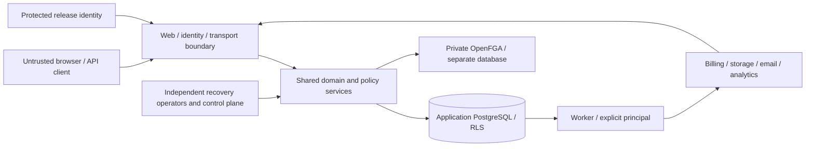

# Phase 0 threat model

Date: 2026-09-22. Scope: the modular monolith, passwordless identity, tenant permissions, provider effects and recovery in the planning documents. This is a design review and test map; passing a prototype does not certify later production modules.

## Assets, actors and boundaries

Protect tenant data and private files; identity/session/passkey material; membership, ownership and grant authority; entitlements/capacity and financial evidence; audit/deletion receipts; release artifacts; recovery epochs and readiness. Attacker profiles include an unauthenticated remote client, a malicious tenant member/owner, a stolen session or API key, a malicious webhook sender, delayed/replayed worker/provider operations, a compromised dependency/CI job, and an operator using an obsolete backup. Service administrators and total cloud-account takeover remain stronger trust assumptions requiring independent controls.

Browser organization IDs, headers, cursor values, URLs and provider metadata never create trusted tenant/principal context. Runtime roles cannot perform migrations, grant database privileges, publish models, or reopen recovery. Web and worker credentials differ, but their default shared container means a compromise can cross that process boundary. PostgreSQL superusers and table owners can bypass ordinary RLS assumptions; tests must use the actual restricted roles. Recovery ownership is independent of application deployment and database restoration.

## Abuse cases and required controls

| Threat / impact | Chosen control | Evidence owner / gate | Residual risk or failure behavior |
| --- | --- | --- | --- |
| Tenant ID substitution, pooled session leakage, cross-tenant FK | Tenant from authenticated membership; transaction-local context; composite same-tenant constraints; restricted FORCE RLS roles | RLS/pool spike; `R-TENANCY` | Missing context denies; migration/owner credentials cannot enter runtime. |
| Cross-tenant cache, sparse list, count/snippet or DTO leakage | No shared tenant response caching; shared authorized list predicates; explicit output schemas; permission checks for fields/counts | API spike; `R-AUTHZ`, `R-SEARCH` | Pagination never exposes unauthorized candidate counts. |
| Stale grant or delayed abandoned graph write | Epoch/model/generation namespaces; unique attempt ownership; compare-and-swap publication against current revision; bounded freshness and fence | Real FGA fault suite; `R-AUTHZ` | Graph timeout/expiry denies; retries cannot publish obsolete generations. |
| Revocation blocked by hot tenant or expensive graph rebuild | Measure first attempts, writer/fence waits, queue bounds, cleanup and create-to-readable under canonical workload | 30-minute benchmark; `R-AUTHZ-PERF` | Failing availability blocks protocol selection, even if denial is safe. |
| Magic-link scanner, replay, open redirect, account enumeration | Confirmation before consuming; hashed expiring single-use secret; atomic consume; generic response; allowlisted redirect | Identity spike; `R-MAGIC` | Email possession alone does not satisfy every elevated-assurance policy. |
| Passkey challenge replay, wrong origin/RP, assurance confusion | Server challenge verification, RP/origin binding, user verification policy; current-session enrollment/revocation; fresh sensitive-action assurance | Identity spike; `R-PASSKEY` | Synced credentials are not proof of hardware binding; verified auth method is retained as evidence. |
| Last owner deleted, inactive recipient accepts transfer, SCIM race | Shared user-before-organization lock order; recipient acceptance/version checks; voluntary last-owner denial; security removal enters owner recovery | Identity races; `R-LIFECYCLE`, `R-OWNER`, `R-TRANSFER` | Security deactivation never waits on FGA or voluntary transfer. |
| Seat/capacity oversubscription or duplicate side effect | Transactional admission/reservation and semantic operation IDs; durable outbox/inbox and reconciliation | `R-SEATS`, `R-POLICY`, Phase 5 billing | Provider idempotency expiry cannot erase the local deduplication obligation. |
| Forged/duplicate/out-of-order billing webhook | Verify raw-body signature; durable inbox; unique event ID plus business-operation identity; provider-state reconciliation | Adapter ADR; Phase 5 Stripe suites | Checkout redirect is never evidence of payment or entitlement. |
| Upload overwrite after scan or presigned URL replay | Staging-only upload; captured immutable version; scan/hash same bytes; version-bound reads; transactional finalization and single settlement | Storage ADR; `R-FILES` | S3 compatibility branding alone is insufficient; provider must pass contract suite. |
| Analytics exfiltration, opted-out retry, deletion resurrection | Server-derived scope; opaque identifiers/property allowlist; authoritative preferences checked at dispatch; independent suppression and drain/delete barrier | Analytics ADR; `R-ANALYTICS` | Ambiguous remote deletion remains pending; provider disabled until contract is proved. |
| Restored credentials/grants/deleted user regain access | Independent journal and epoch; close gates before restore; invalidate restored credentials; independent owner/identity/access revalidation | Recovery ADR; `R-RECOVERY` | Owner cannot be verified using only the snapshot; unverified organizations remain unavailable. |
| CI token/image/config substitution | Read-only PR identity; environment-specific OIDC; immutable digests/action commits; signed provenance; separate infra/bootstrap identities | Deployment ADR; `R-DEPLOY` | A combined-host root compromise compromises that application environment; independent recovery keys are excluded. |
| Secrets in logs, errors, URLs or emails | Structured allowlist/redaction; generic auth errors; strip magic tokens from logs/referrers; restricted audit sink | `R-EMAIL`, runtime tests | Audits retain necessary actor references under separate retention policy. |
| SSRF or webhook egress to internal services | Connector URL validation, approved destinations, redirect/DNS rebinding controls; deny metadata/private endpoints; bounded payload/timeouts | Phase 6 integrations | Network policy complements validation; no arbitrary URL proxy. |
| Deletion acknowledged without durable independent evidence | Freeze local intent first; acknowledge only after independently durable journal receipt; retry and replay before purge/readiness | Recovery ADR; `R-ACCOUNT`, `R-ORG-DATA` | Journal outage delays scheduled/completed status and purge. |

## Review findings and decisions

The highest-risk coupled assumptions are graph availability under create/revoke churn, passwordless assurance plus lifecycle locking, and restoring security state independently from data. These receive real-service Phase 0 spikes. No cache, application row flag, or test double substitutes for proving these boundaries.

The reference host is a single availability/security domain. The 99.9% objective is a target pending deployed measurements; the Phase 0 30-minute benchmark cannot establish a monthly SLA. Recovery's four-hour objective cannot be promised for organizations awaiting human identity/owner revalidation; [ADR-0003](recovery.md) records a narrower machine target and the unresolved business commitment.

Before customer data, the implementation must demonstrate key replacement, immutable-file identity, journal replay/completeness, provider cleanup, and current grant revalidation in deployed restore drills. A missing named infrastructure/recovery owner or unproved adapter capability remains an explicit release blocker. Required scenario definitions remain canonical in the linked roadmap gates, not silently weakened by this summary.
